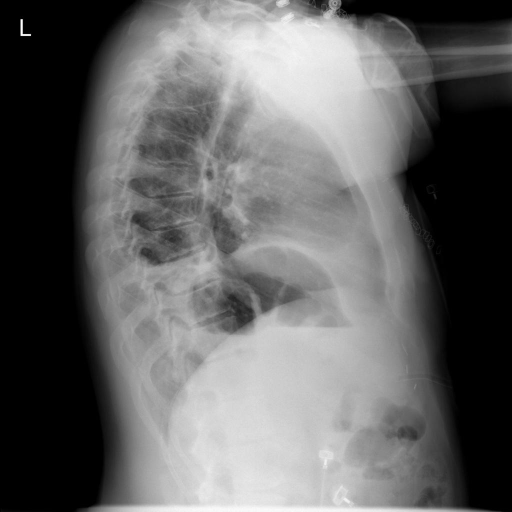

# chexbench_openi_0000
Ordinal 239; source OpenI; stopped-prefix record.

Which finding is in this chest X-ray?

## Complete options

- **A**: elevated right diaphragm
- **B**: elevated left diaphragm

## Original images

Explicit answer: **B. elevated left diaphragm**; reference: **B**; correct: **True**.

Two of three expert models (chest_xray_expert and llava_rad) identified left hemidiaphragm elevation, while grounding failed to localize; the consensus supports option B.

[Prediction](../../evidence/chexbench/predictions/M43-IM-GT-S50-CXR6/chexbench_openi_0000.json) · [own post-prediction feedback](../../evidence/chexbench/feedback/chexbench_openi_0000.json) · [exact context and Skill version](../../evidence/chexbench/contexts/chexbench_openi_0000.json) · [all main requests/responses](../../evidence/chexbench/services/calls/R50-AGENT/chexbench_openi_0000)

## Tool requests and observations

- medgemma: status=completed; [selection](../../evidence/chexbench/services/tool_selections/R50-AGENT/chexbench_openi_0000/1.json), [full request/result/stdout/stderr artifacts](../../evidence/chexbench/services/tool_cache/826d3e02fe63127aa8d92bdff9e0e9ec0d8640154145a82c58c82bc15ebafd6c).
- chest_xray_expert: status=completed; [selection](../../evidence/chexbench/services/tool_selections/R50-AGENT/chexbench_openi_0000/2.json), [full request/result/stdout/stderr artifacts](../../evidence/chexbench/services/tool_cache/e5b9a64f88dba4f71f2917f5d900436920aee9981e4d1e13de508ad2175e2e60).
- xray_phrase_grounding: status=completed; [selection](../../evidence/chexbench/services/tool_selections/R50-AGENT/chexbench_openi_0000/3.json), [full request/result/stdout/stderr artifacts](../../evidence/chexbench/services/tool_cache/56c7f3812cdfae791b8f9b7f87070052c3eb8d68ba2bb6d871e15dde279f02d7).
- llava_rad: status=completed; [selection](../../evidence/chexbench/services/tool_selections/R50-AGENT/chexbench_openi_0000/4.json), [full request/result/stdout/stderr artifacts](../../evidence/chexbench/services/tool_cache/d80b7358875842b2a099cf19d11b2316cfb5041c1f10e79e84e6ab9bafe39797).

## Skill and prior-image provenance

Selected IDs: []; prior same-image IDs: [].

This is dataset-label scoring and model/tool narrative, not clinical adjudication or Skill causal verification.
