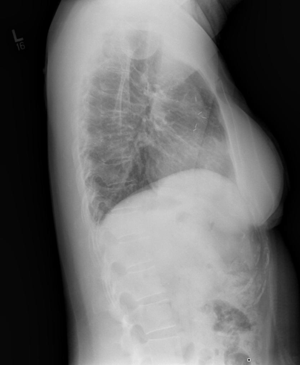

# chexbench_openi_0001
Ordinal 240; source OpenI; stopped-prefix record.

Which finding is in this chest X-ray?

## Complete options

- **A**: surgical instruments in the right lung
- **B**: surgical instruments in the left lung

## Original images

Explicit answer: **B. surgical instruments in the left lung**; reference: **B**; correct: **True**.

Chest X-ray expert confirmed surgical instruments are visible in the left lung field on this lateral view.

[Prediction](../../evidence/chexbench/predictions/M43-IM-GT-S50-CXR6/chexbench_openi_0001.json) · [own post-prediction feedback](../../evidence/chexbench/feedback/chexbench_openi_0001.json) · [exact context and Skill version](../../evidence/chexbench/contexts/chexbench_openi_0001.json) · [all main requests/responses](../../evidence/chexbench/services/calls/R50-AGENT/chexbench_openi_0001)

## Tool requests and observations

- xray_phrase_grounding: status=completed; [selection](../../evidence/chexbench/services/tool_selections/R50-AGENT/chexbench_openi_0001/1.json), [full request/result/stdout/stderr artifacts](../../evidence/chexbench/services/tool_cache/3ac87641adeb6534e504d47918bf2eda17404e76014a7a962fedbe18e541cfac).
- chest_xray_expert: status=completed; [selection](../../evidence/chexbench/services/tool_selections/R50-AGENT/chexbench_openi_0001/2.json), [full request/result/stdout/stderr artifacts](../../evidence/chexbench/services/tool_cache/28ae6beafdd4db42b8c36f888ab5e62aadecaf23369b2b5625b9ab851e9bd755).

## Skill and prior-image provenance

Selected IDs: []; prior same-image IDs: [].

This is dataset-label scoring and model/tool narrative, not clinical adjudication or Skill causal verification.
