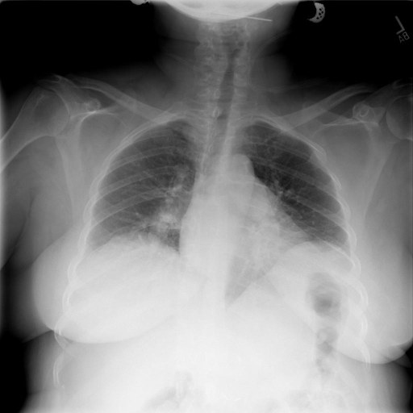
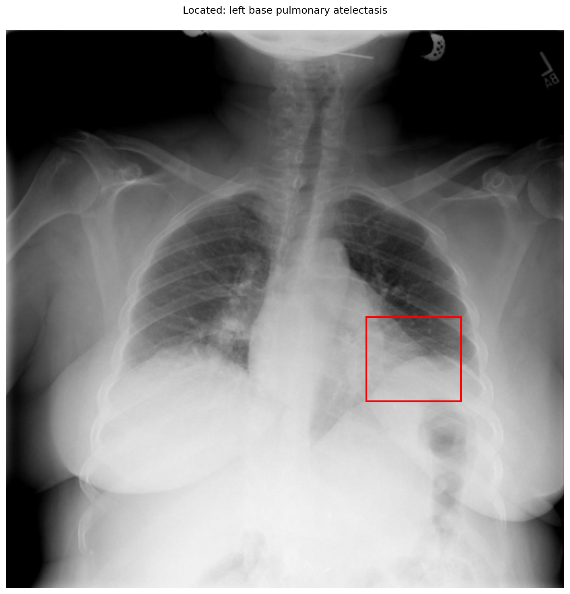

# chexbench_openi_0002
Ordinal 241; source OpenI; stopped-prefix record.

Which finding is in this chest X-ray?

## Complete options

- **A**: left base pulmonary atelectasis
- **B**: right base pulmonary atelectasis

## Original images

Explicit answer: **A. left base pulmonary atelectasis**; reference: **B**; correct: **False**.

Phrase grounding localized the finding to the left lung base (image coordinates [0.64, 0.51, 0.81, 0.66]), and chest_xray_expert confirmed left lung base involvement.

[Prediction](../../evidence/chexbench/predictions/M43-IM-GT-S50-CXR6/chexbench_openi_0002.json) · [own post-prediction feedback](../../evidence/chexbench/feedback/chexbench_openi_0002.json) · [exact context and Skill version](../../evidence/chexbench/contexts/chexbench_openi_0002.json) · [all main requests/responses](../../evidence/chexbench/services/calls/R50-AGENT/chexbench_openi_0002)

## Tool requests and observations

- medgemma: status=completed; [selection](../../evidence/chexbench/services/tool_selections/R50-AGENT/chexbench_openi_0002/1.json), [full request/result/stdout/stderr artifacts](../../evidence/chexbench/services/tool_cache/1530b7972df142faa2c1f1f2e1da63db0d11d5daa8f7c73895e2cce6a1199b1e).
- chest_xray_expert: status=completed; [selection](../../evidence/chexbench/services/tool_selections/R50-AGENT/chexbench_openi_0002/2.json), [full request/result/stdout/stderr artifacts](../../evidence/chexbench/services/tool_cache/ef1c73815c4d7d92cdc02ad3329db7c360dc718ad10e305b14eb51998b61fc99).
- xray_phrase_grounding: status=completed; [selection](../../evidence/chexbench/services/tool_selections/R50-AGENT/chexbench_openi_0002/3.json), [full request/result/stdout/stderr artifacts](../../evidence/chexbench/services/tool_cache/c582a5cf1a0fb144598a942b07480dd136e6aa0d57eb45311f8b4dc113412e96).

## Skill and prior-image provenance

Selected IDs: []; prior same-image IDs: [].

This is dataset-label scoring and model/tool narrative, not clinical adjudication or Skill causal verification.
