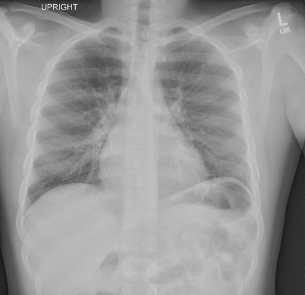
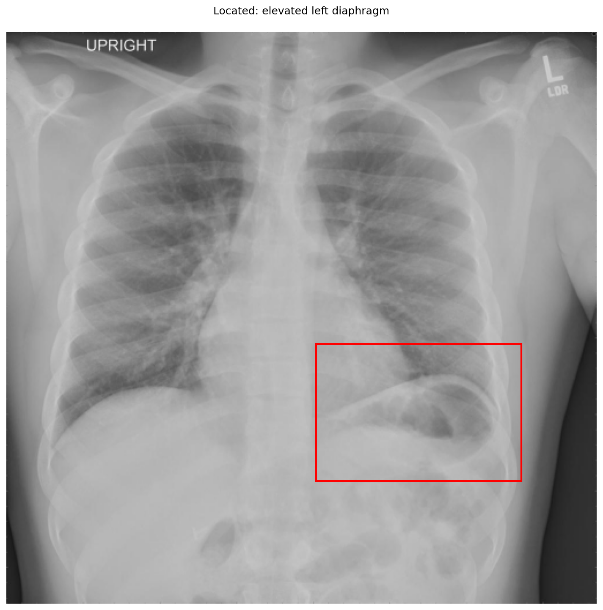
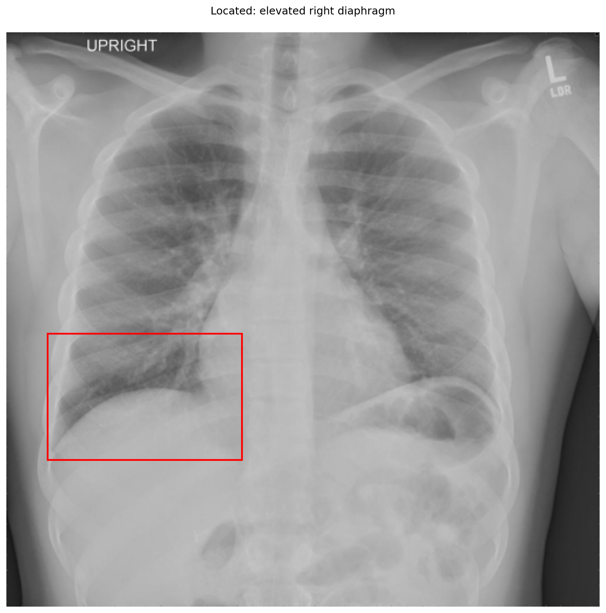

# chexbench_openi_0003
Ordinal 242; source OpenI; stopped-prefix record.

Which finding is in this chest X-ray?

## Complete options

- **A**: elevated right diaphragm
- **B**: elevated left diaphragm

## Original images

Explicit answer: **B. elevated left diaphragm**; reference: **B**; correct: **True**.

The left hemidiaphragm is visibly higher than the right, with a gastric bubble beneath it, confirming elevation on the patient's left side.

[Prediction](../../evidence/chexbench/predictions/M43-IM-GT-S50-CXR6/chexbench_openi_0003.json) · [own post-prediction feedback](../../evidence/chexbench/feedback/chexbench_openi_0003.json) · [exact context and Skill version](../../evidence/chexbench/contexts/chexbench_openi_0003.json) · [all main requests/responses](../../evidence/chexbench/services/calls/R50-AGENT/chexbench_openi_0003)

## Tool requests and observations

- xray_phrase_grounding: status=completed; [selection](../../evidence/chexbench/services/tool_selections/R50-AGENT/chexbench_openi_0003/1.json), [full request/result/stdout/stderr artifacts](../../evidence/chexbench/services/tool_cache/ac3b97ec37fb6f700e13bf77d05fed0b2f461f612fb5de4dfcaaa28f8d3ec769).

- xray_phrase_grounding: status=completed; [selection](../../evidence/chexbench/services/tool_selections/R50-AGENT/chexbench_openi_0003/2.json), [full request/result/stdout/stderr artifacts](../../evidence/chexbench/services/tool_cache/3c7686d3f4e1b59c4339b9caa79302507d99453f5ba2c136a16124dcf6c7d744).

## Skill and prior-image provenance

Selected IDs: []; prior same-image IDs: [].

This is dataset-label scoring and model/tool narrative, not clinical adjudication or Skill causal verification.
