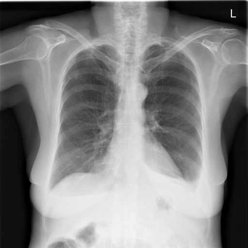
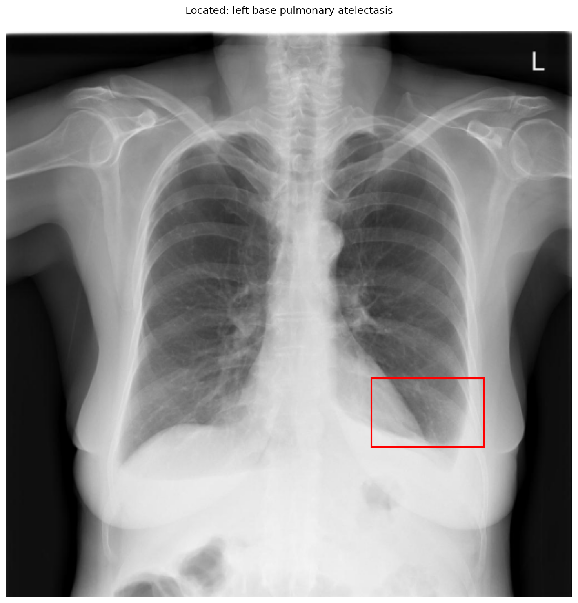

# chexbench_openi_0004
Ordinal 243; source OpenI; stopped-prefix record.

Which finding is in this chest X-ray?

## Complete options

- **A**: right base pulmonary atelectasis
- **B**: left base pulmonary atelectasis

## Original images

Explicit answer: **B. left base pulmonary atelectasis**; reference: **B**; correct: **True**.

Grounding visualization confirms opacity and blunting at the left lung base consistent with atelectasis, while the right base appears clear.

[Prediction](../../evidence/chexbench/predictions/M43-IM-GT-S50-CXR6/chexbench_openi_0004.json) · [own post-prediction feedback](../../evidence/chexbench/feedback/chexbench_openi_0004.json) · [exact context and Skill version](../../evidence/chexbench/contexts/chexbench_openi_0004.json) · [all main requests/responses](../../evidence/chexbench/services/calls/R50-AGENT/chexbench_openi_0004)

## Tool requests and observations

- medgemma: status=completed; [selection](../../evidence/chexbench/services/tool_selections/R50-AGENT/chexbench_openi_0004/1.json), [full request/result/stdout/stderr artifacts](../../evidence/chexbench/services/tool_cache/c929d35c0b69c15cbe22218c07c9dbb362cc9f80a04d3bfe4be1151e783878c6).
- xray_phrase_grounding: status=completed; [selection](../../evidence/chexbench/services/tool_selections/R50-AGENT/chexbench_openi_0004/2.json), [full request/result/stdout/stderr artifacts](../../evidence/chexbench/services/tool_cache/c57fb3705aedf044ff1f288ccf95add632fbb91a538e2c08cc1e76e31ac19b80).

## Skill and prior-image provenance

Selected IDs: []; prior same-image IDs: [].

This is dataset-label scoring and model/tool narrative, not clinical adjudication or Skill causal verification.
