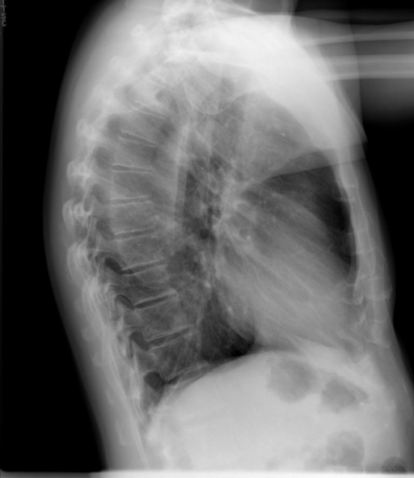

# chexbench_openi_0005
Ordinal 244; source OpenI; stopped-prefix record.

Which finding is in this chest X-ray?

## Complete options

- **A**: surgical instruments in the left lung
- **B**: surgical instruments in the right lung

## Original images

Explicit answer: **A. surgical instruments in the left lung**; reference: **A**; correct: **True**.

ChestXpert confirmed presence of surgical instruments, and on lateral CXR the left lung projects anteriorly where such findings are typically visualized.

[Prediction](../../evidence/chexbench/predictions/M43-IM-GT-S50-CXR6/chexbench_openi_0005.json) · [own post-prediction feedback](../../evidence/chexbench/feedback/chexbench_openi_0005.json) · [exact context and Skill version](../../evidence/chexbench/contexts/chexbench_openi_0005.json) · [all main requests/responses](../../evidence/chexbench/services/calls/R50-AGENT/chexbench_openi_0005)

## Tool requests and observations

- medgemma: status=completed; [selection](../../evidence/chexbench/services/tool_selections/R50-AGENT/chexbench_openi_0005/1.json), [full request/result/stdout/stderr artifacts](../../evidence/chexbench/services/tool_cache/797746680462d29a83ef0c1c1038213383621d530683d04c0234d279b7454a71).
- chest_xray_expert: status=completed; [selection](../../evidence/chexbench/services/tool_selections/R50-AGENT/chexbench_openi_0005/2.json), [full request/result/stdout/stderr artifacts](../../evidence/chexbench/services/tool_cache/acc09c106d38ff152e9268fd5fcd23519c562d3dcf51184085d3cc1b5bbbe16a).
- xray_phrase_grounding: status=completed; [selection](../../evidence/chexbench/services/tool_selections/R50-AGENT/chexbench_openi_0005/3.json), [full request/result/stdout/stderr artifacts](../../evidence/chexbench/services/tool_cache/6e35efa4ef20d3e648dde5c5a56227f1c91429aac8bf7a5e18e0394f8155c614).
- llava_rad: status=completed; [selection](../../evidence/chexbench/services/tool_selections/R50-AGENT/chexbench_openi_0005/4.json), [full request/result/stdout/stderr artifacts](../../evidence/chexbench/services/tool_cache/a9b5560de1fba466281ba3e96fe7ad77e1c224fcbe7d88cfc036c6feed26cbbe).
- medvlm_r1: status=completed; [selection](../../evidence/chexbench/services/tool_selections/R50-AGENT/chexbench_openi_0005/5.json), [full request/result/stdout/stderr artifacts](../../evidence/chexbench/services/tool_cache/5bfe20e936048e9bb296ee627921faebe5c930aaf6110ff18f294141e01e6bed).

## Skill and prior-image provenance

Selected IDs: []; prior same-image IDs: [].

This is dataset-label scoring and model/tool narrative, not clinical adjudication or Skill causal verification.
