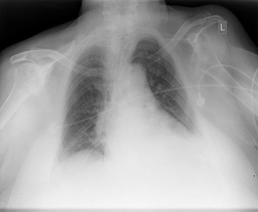
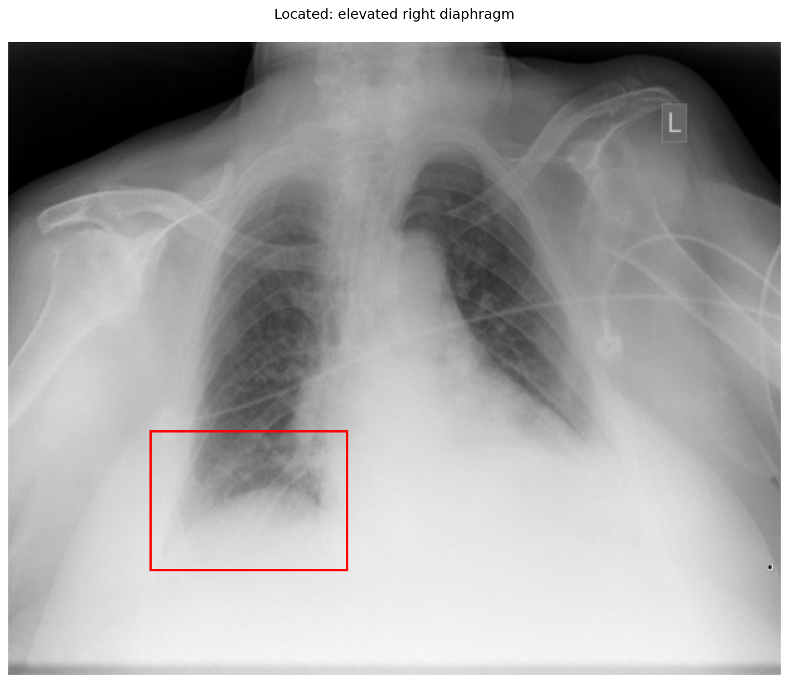
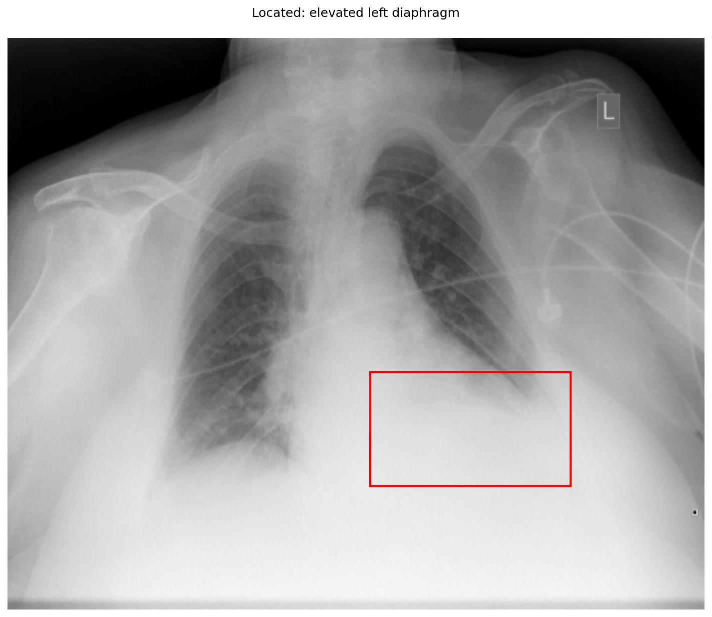

# chexbench_openi_0006
Ordinal 245; source OpenI; stopped-prefix record.

Which finding is in this chest X-ray?

## Complete options

- **A**: elevated right diaphragm
- **B**: elevated left diaphragm

## Original images

Explicit answer: **B. elevated left diaphragm**; reference: **B**; correct: **True**.

The left hemidiaphragm is obscured and positioned higher than the right, with dense opacity in the left lower zone consistent with elevation or subpulmonic effusion, while the right diaphragm appears at a normal level.

[Prediction](../../evidence/chexbench/predictions/M43-IM-GT-S50-CXR6/chexbench_openi_0006.json) · [own post-prediction feedback](../../evidence/chexbench/feedback/chexbench_openi_0006.json) · [exact context and Skill version](../../evidence/chexbench/contexts/chexbench_openi_0006.json) · [all main requests/responses](../../evidence/chexbench/services/calls/R50-AGENT/chexbench_openi_0006)

## Tool requests and observations

- xray_phrase_grounding: status=completed; [selection](../../evidence/chexbench/services/tool_selections/R50-AGENT/chexbench_openi_0006/1.json), [full request/result/stdout/stderr artifacts](../../evidence/chexbench/services/tool_cache/fe2c66857e404d7cd25c7a2a496eec1eb6e427f23579fdb3699bae14e617d810).

- xray_phrase_grounding: status=completed; [selection](../../evidence/chexbench/services/tool_selections/R50-AGENT/chexbench_openi_0006/2.json), [full request/result/stdout/stderr artifacts](../../evidence/chexbench/services/tool_cache/e478352a98eb5621f163363bdba92a3946f03127342e398dce7d5c5e1d5ebe8e).

## Skill and prior-image provenance

Selected IDs: []; prior same-image IDs: [].

This is dataset-label scoring and model/tool narrative, not clinical adjudication or Skill causal verification.
