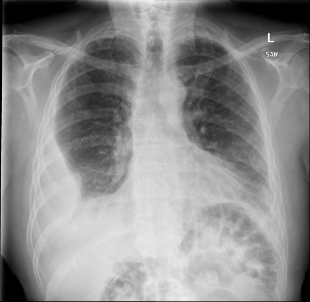
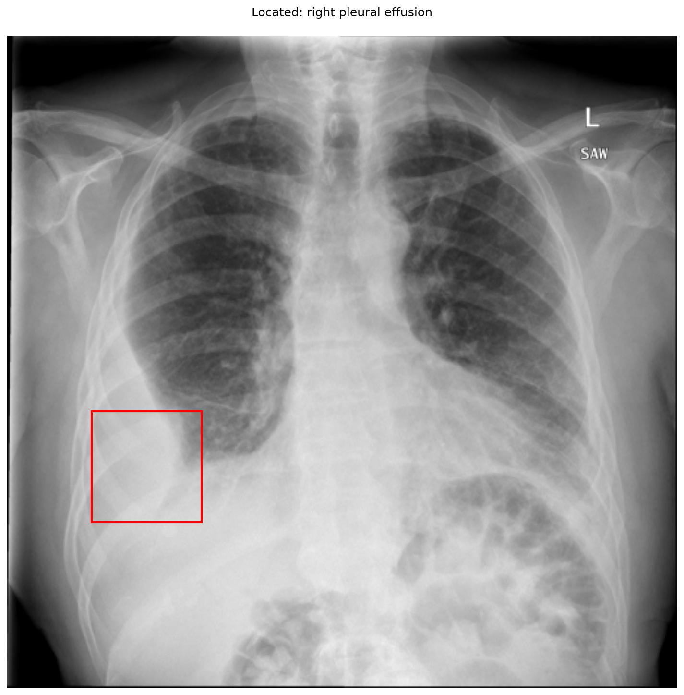

# chexbench_openi_0007
Ordinal 246; source OpenI; stopped-prefix record.

Which finding is in this chest X-ray?

## Complete options

- **A**: right pleural effusion
- **B**: left pleural effusion

## Original images

Explicit answer: **A. right pleural effusion**; reference: **A**; correct: **True**.

Grounding visualization confirms opacity in the right lower hemithorax consistent with right pleural effusion, while the left side appears clear.

[Prediction](../../evidence/chexbench/predictions/M43-IM-GT-S50-CXR6/chexbench_openi_0007.json) · [own post-prediction feedback](../../evidence/chexbench/feedback/chexbench_openi_0007.json) · [exact context and Skill version](../../evidence/chexbench/contexts/chexbench_openi_0007.json) · [all main requests/responses](../../evidence/chexbench/services/calls/R50-AGENT/chexbench_openi_0007)

## Tool requests and observations

- medgemma: status=completed; [selection](../../evidence/chexbench/services/tool_selections/R50-AGENT/chexbench_openi_0007/1.json), [full request/result/stdout/stderr artifacts](../../evidence/chexbench/services/tool_cache/2c8b0e848f6c6457f2f408d057927df67ddf432d2f3d00587b6c324f03ef8217).
- xray_phrase_grounding: status=completed; [selection](../../evidence/chexbench/services/tool_selections/R50-AGENT/chexbench_openi_0007/2.json), [full request/result/stdout/stderr artifacts](../../evidence/chexbench/services/tool_cache/cbe41d542e28ce09441456b0d899a8115755cd3555649abefc3cff71f1c7f554).

## Skill and prior-image provenance

Selected IDs: []; prior same-image IDs: [].

This is dataset-label scoring and model/tool narrative, not clinical adjudication or Skill causal verification.
