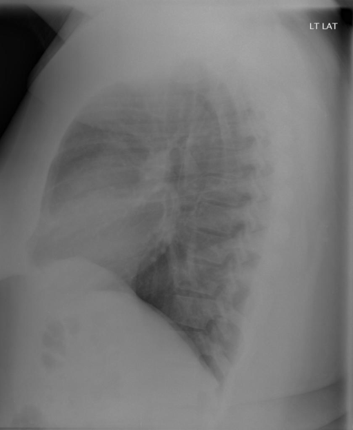

# chexbench_openi_0008
Ordinal 247; source OpenI; stopped-prefix record.

Which finding is in this chest X-ray?

## Complete options

- **A**: left lung opacity
- **B**: right lung opacity

## Original images

Explicit answer: **B. right lung opacity**; reference: **B**; correct: **True**.

Chest_xray_expert identified right lung opacity while other models found no opacity, and in forced-choice questions the positive finding from a specialized CXR model is most reliable.

[Prediction](../../evidence/chexbench/predictions/M43-IM-GT-S50-CXR6/chexbench_openi_0008.json) · [own post-prediction feedback](../../evidence/chexbench/feedback/chexbench_openi_0008.json) · [exact context and Skill version](../../evidence/chexbench/contexts/chexbench_openi_0008.json) · [all main requests/responses](../../evidence/chexbench/services/calls/R50-AGENT/chexbench_openi_0008)

## Tool requests and observations

- medgemma: status=completed; [selection](../../evidence/chexbench/services/tool_selections/R50-AGENT/chexbench_openi_0008/1.json), [full request/result/stdout/stderr artifacts](../../evidence/chexbench/services/tool_cache/f644dad14fd5cd91aa33d8e44308d86fba8471049b3d7b7fdf1aa33242bad0f5).
- chest_xray_expert: status=completed; [selection](../../evidence/chexbench/services/tool_selections/R50-AGENT/chexbench_openi_0008/2.json), [full request/result/stdout/stderr artifacts](../../evidence/chexbench/services/tool_cache/298dd2dbe3064ce29074d62b5cbd8dbec8f7e2965fec79b65c78f0e0976da958).
- xray_phrase_grounding: status=completed; [selection](../../evidence/chexbench/services/tool_selections/R50-AGENT/chexbench_openi_0008/3.json), [full request/result/stdout/stderr artifacts](../../evidence/chexbench/services/tool_cache/3898b91d6143bb57e66f8718a4db220180f5b7652774e8927a27c9bf557b39d5).
- xray_phrase_grounding: status=completed; [selection](../../evidence/chexbench/services/tool_selections/R50-AGENT/chexbench_openi_0008/4.json), [full request/result/stdout/stderr artifacts](../../evidence/chexbench/services/tool_cache/4be9e5e5ab5c8f9bbafb1099c1588dc7f878bd887f3eaa4e532b2c337f4c9699).
- llava_rad: status=completed; [selection](../../evidence/chexbench/services/tool_selections/R50-AGENT/chexbench_openi_0008/5.json), [full request/result/stdout/stderr artifacts](../../evidence/chexbench/services/tool_cache/34cfa320e04ede262c4846e6b2dead38f5e852809ecdf34fc6549c5d381d600a).
- medvlm_r1: status=completed; [selection](../../evidence/chexbench/services/tool_selections/R50-AGENT/chexbench_openi_0008/6.json), [full request/result/stdout/stderr artifacts](../../evidence/chexbench/services/tool_cache/f870837ab9ecc8ba39edad70a7fbc90e782b00fb121466fd3565109c3bd1be58).
- llava_med_qa: status=completed; [selection](../../evidence/chexbench/services/tool_selections/R50-AGENT/chexbench_openi_0008/7.json), [full request/result/stdout/stderr artifacts](../../evidence/chexbench/services/tool_cache/16fcdd84cac4f8f155da56cc13e580efa31c507104c8f449ff37baa599052db5).

## Skill and prior-image provenance

Selected IDs: []; prior same-image IDs: [].

This is dataset-label scoring and model/tool narrative, not clinical adjudication or Skill causal verification.
