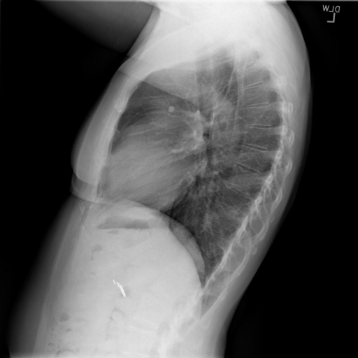

# chexbench_openi_0009
Ordinal 248; source OpenI; stopped-prefix record.

Which finding is in this chest X-ray?

## Complete options

- **A**: surgical instruments in the right lung
- **B**: surgical instruments in the left lung

## Original images

Explicit answer: **A. surgical instruments in the right lung**; reference: **A**; correct: **True**.

The chest X-ray expert tool identified the visible metallic surgical clip as being located in the right lung field.

[Prediction](../../evidence/chexbench/predictions/M43-IM-GT-S50-CXR6/chexbench_openi_0009.json) · [own post-prediction feedback](../../evidence/chexbench/feedback/chexbench_openi_0009.json) · [exact context and Skill version](../../evidence/chexbench/contexts/chexbench_openi_0009.json) · [all main requests/responses](../../evidence/chexbench/services/calls/R50-AGENT/chexbench_openi_0009)

## Tool requests and observations

- xray_phrase_grounding: status=completed; [selection](../../evidence/chexbench/services/tool_selections/R50-AGENT/chexbench_openi_0009/1.json), [full request/result/stdout/stderr artifacts](../../evidence/chexbench/services/tool_cache/30a47a90852be64a5a0557b7b2bfeb0c503f6711342536e15f10973370c0b3e5).
- chest_xray_expert: status=completed; [selection](../../evidence/chexbench/services/tool_selections/R50-AGENT/chexbench_openi_0009/2.json), [full request/result/stdout/stderr artifacts](../../evidence/chexbench/services/tool_cache/4b8bbc3d940f38c4eaec11cb17ca894db34108065e4f050a99a0ab32a9342c0d).
- chest_xray_expert: status=completed; [selection](../../evidence/chexbench/services/tool_selections/R50-AGENT/chexbench_openi_0009/3.json), [full request/result/stdout/stderr artifacts](../../evidence/chexbench/services/tool_cache/c1e34cc75b414be78a777c36f9aa03756af830f3b4db0136b87861b0fc1e63e1).

## Skill and prior-image provenance

Selected IDs: []; prior same-image IDs: [].

This is dataset-label scoring and model/tool narrative, not clinical adjudication or Skill causal verification.
