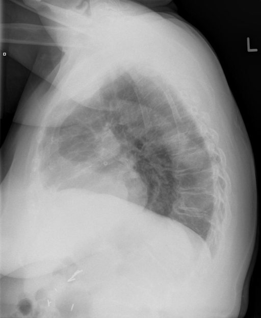
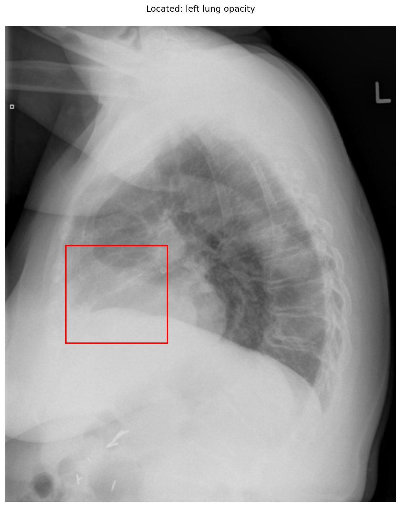

# chexbench_openi_0010
Ordinal 249; source OpenI; stopped-prefix record.

Which finding is in this chest X-ray?

## Complete options

- **A**: right lung opacity
- **B**: left lung opacity

## Original images

Explicit answer: **B. left lung opacity**; reference: **B**; correct: **True**.

Phrase grounding localized the opacity to the left lung (bounding box [0.154, 0.461, 0.414, 0.666]) while right lung opacity grounding returned no finding, confirming left-sided involvement.

[Prediction](../../evidence/chexbench/predictions/M43-IM-GT-S50-CXR6/chexbench_openi_0010.json) · [own post-prediction feedback](../../evidence/chexbench/feedback/chexbench_openi_0010.json) · [exact context and Skill version](../../evidence/chexbench/contexts/chexbench_openi_0010.json) · [all main requests/responses](../../evidence/chexbench/services/calls/R50-AGENT/chexbench_openi_0010)

## Tool requests and observations

- medgemma: status=completed; [selection](../../evidence/chexbench/services/tool_selections/R50-AGENT/chexbench_openi_0010/1.json), [full request/result/stdout/stderr artifacts](../../evidence/chexbench/services/tool_cache/e0ceac8da71af52f673053215ad67d3c6e9542707abd02baecc693b598f78501).
- chest_xray_expert: status=completed; [selection](../../evidence/chexbench/services/tool_selections/R50-AGENT/chexbench_openi_0010/2.json), [full request/result/stdout/stderr artifacts](../../evidence/chexbench/services/tool_cache/8d89c06a9b66966bae3268c1740c32aa309559d8df6be5612f459df94aab12b4).
- xray_phrase_grounding: status=completed; [selection](../../evidence/chexbench/services/tool_selections/R50-AGENT/chexbench_openi_0010/3.json), [full request/result/stdout/stderr artifacts](../../evidence/chexbench/services/tool_cache/1add61ff5b42206ce77984cb5b8dcdd397742ba74ab4e3c5c3d0826aa0c9d982).
- xray_phrase_grounding: status=completed; [selection](../../evidence/chexbench/services/tool_selections/R50-AGENT/chexbench_openi_0010/4.json), [full request/result/stdout/stderr artifacts](../../evidence/chexbench/services/tool_cache/603101008ea5b5b94908a90801df7702e547b8f32aa8279a832e6f704ed3c5f5).

## Skill and prior-image provenance

Selected IDs: []; prior same-image IDs: [].

This is dataset-label scoring and model/tool narrative, not clinical adjudication or Skill causal verification.
