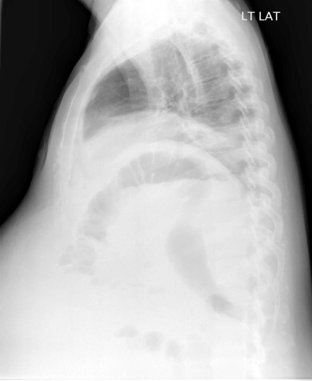

# chexbench_openi_0011
Ordinal 250; source OpenI; stopped-prefix record.

Which finding is in this chest X-ray?

## Complete options

- **A**: large right pleural effusion
- **B**: large left pleural effusion

## Original images

Explicit answer: **A. large right pleural effusion**; reference: **A**; correct: **True**.

Both medgemma and chest_xray_expert identify a significant/large right pleural effusion on the lateral view.

[Prediction](../../evidence/chexbench/predictions/M43-IM-GT-S50-CXR6/chexbench_openi_0011.json) · [own post-prediction feedback](../../evidence/chexbench/feedback/chexbench_openi_0011.json) · [exact context and Skill version](../../evidence/chexbench/contexts/chexbench_openi_0011.json) · [all main requests/responses](../../evidence/chexbench/services/calls/R50-AGENT/chexbench_openi_0011)

## Tool requests and observations

- medgemma: status=completed; [selection](../../evidence/chexbench/services/tool_selections/R50-AGENT/chexbench_openi_0011/1.json), [full request/result/stdout/stderr artifacts](../../evidence/chexbench/services/tool_cache/8950cd1bec1125888223150aa8fd34f34fbedff3b2b81f4c18c92e1e81ccc7e9).
- chest_xray_expert: status=completed; [selection](../../evidence/chexbench/services/tool_selections/R50-AGENT/chexbench_openi_0011/2.json), [full request/result/stdout/stderr artifacts](../../evidence/chexbench/services/tool_cache/8c23964521746deff74e5b37a18c9f55ef5c3645f55ecd5c70eb6c13be452995).

## Skill and prior-image provenance

Selected IDs: []; prior same-image IDs: [].

This is dataset-label scoring and model/tool narrative, not clinical adjudication or Skill causal verification.
