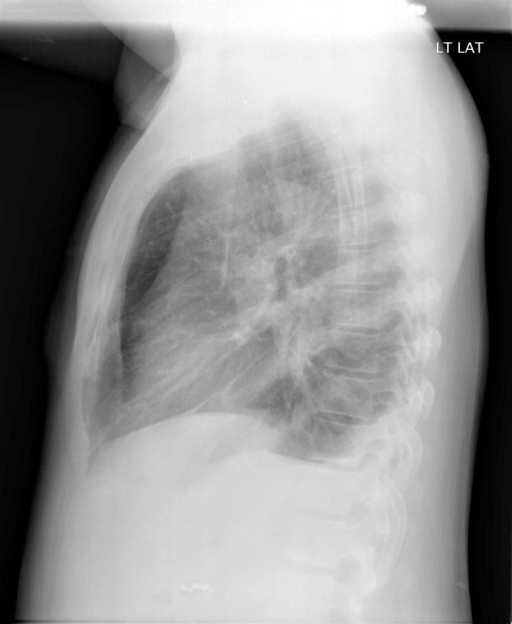
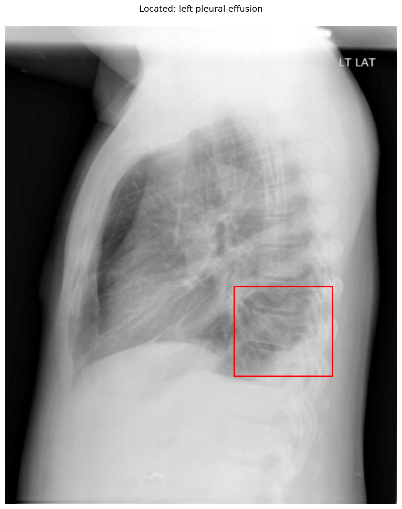

# chexbench_openi_0012
Ordinal 251; source OpenI; stopped-prefix record.

Which finding is in this chest X-ray?

## Complete options

- **A**: small left pleural effusion
- **B**: small right pleural effusion

## Original images

Explicit answer: **A. small left pleural effusion**; reference: **B**; correct: **False**.

The lateral chest X-ray shows blunting of the posterior costophrenic angle, and phrase grounding confirms a left-sided pleural effusion.

[Prediction](../../evidence/chexbench/predictions/M43-IM-GT-S50-CXR6/chexbench_openi_0012.json) · [own post-prediction feedback](../../evidence/chexbench/feedback/chexbench_openi_0012.json) · [exact context and Skill version](../../evidence/chexbench/contexts/chexbench_openi_0012.json) · [all main requests/responses](../../evidence/chexbench/services/calls/R50-AGENT/chexbench_openi_0012)

## Tool requests and observations

- medgemma: status=completed; [selection](../../evidence/chexbench/services/tool_selections/R50-AGENT/chexbench_openi_0012/1.json), [full request/result/stdout/stderr artifacts](../../evidence/chexbench/services/tool_cache/2cdfbfc066f13c2389f70c1cf725af41babe3a6b3625fa5bce45bd240e7a70b2).
- chest_xray_expert: status=completed; [selection](../../evidence/chexbench/services/tool_selections/R50-AGENT/chexbench_openi_0012/2.json), [full request/result/stdout/stderr artifacts](../../evidence/chexbench/services/tool_cache/b988eae4831295b2cad50f4793d753aa72e27ad4a1023c327f2da2a91c218723).
- xray_phrase_grounding: status=completed; [selection](../../evidence/chexbench/services/tool_selections/R50-AGENT/chexbench_openi_0012/3.json), [full request/result/stdout/stderr artifacts](../../evidence/chexbench/services/tool_cache/66e03d9a744b6fbfc08de781b9a976d207328f75465dd3ce860ad0e43f0bfc6f).

## Skill and prior-image provenance

Selected IDs: []; prior same-image IDs: [].

This is dataset-label scoring and model/tool narrative, not clinical adjudication or Skill causal verification.
