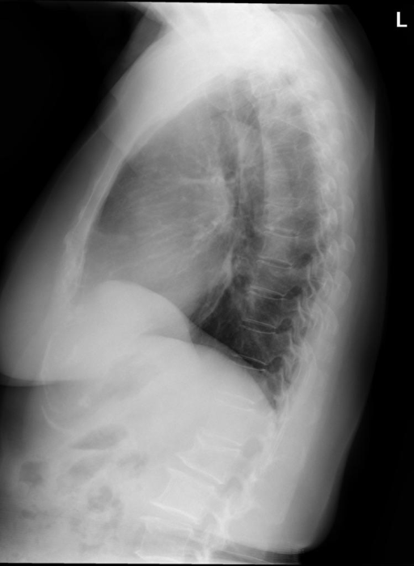

# chexbench_openi_0013
Ordinal 252; source OpenI; stopped-prefix record.

Which finding is in this chest X-ray?

## Complete options

- **A**: elevated right diaphragm
- **B**: elevated left diaphragm

## Original images

Explicit answer: **A. elevated right diaphragm**; reference: **A**; correct: **True**.

Both MedGemma and CheXagent independently identified elevation of the right hemidiaphragm on this lateral chest X-ray.

[Prediction](../../evidence/chexbench/predictions/M43-IM-GT-S50-CXR6/chexbench_openi_0013.json) · [own post-prediction feedback](../../evidence/chexbench/feedback/chexbench_openi_0013.json) · [exact context and Skill version](../../evidence/chexbench/contexts/chexbench_openi_0013.json) · [all main requests/responses](../../evidence/chexbench/services/calls/R50-AGENT/chexbench_openi_0013)

## Tool requests and observations

- medgemma: status=completed; [selection](../../evidence/chexbench/services/tool_selections/R50-AGENT/chexbench_openi_0013/1.json), [full request/result/stdout/stderr artifacts](../../evidence/chexbench/services/tool_cache/9f7de7efc7d8cb06736f65784ea46d057304df0bb24ca58bceb35792997b44fa).
- chest_xray_expert: status=completed; [selection](../../evidence/chexbench/services/tool_selections/R50-AGENT/chexbench_openi_0013/2.json), [full request/result/stdout/stderr artifacts](../../evidence/chexbench/services/tool_cache/37e960fd926661e93e70fb1b0d0b27620403a8fe8acd8ee0eca22dc47eb2acf1).

## Skill and prior-image provenance

Selected IDs: []; prior same-image IDs: [].

This is dataset-label scoring and model/tool narrative, not clinical adjudication or Skill causal verification.
