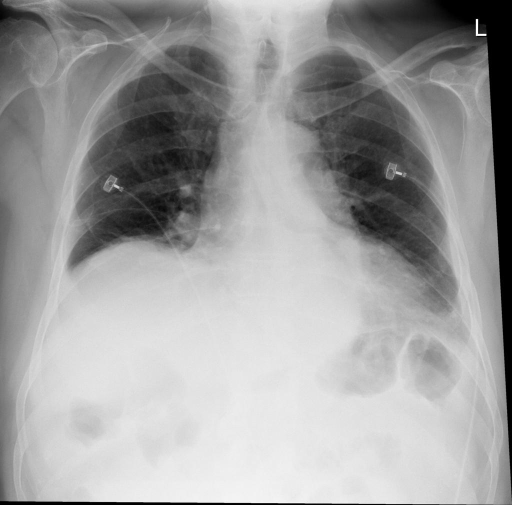
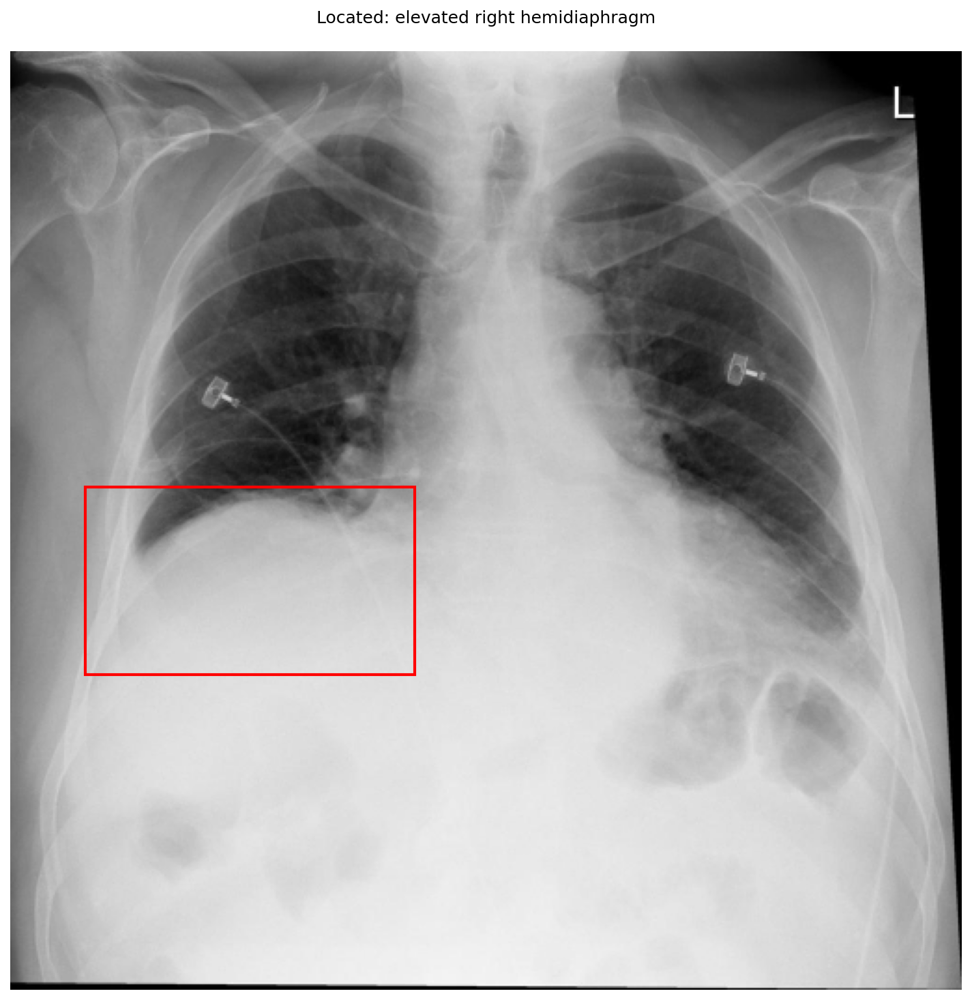

# chexbench_openi_0014
Ordinal 253; source OpenI; stopped-prefix record.

Which finding is in this chest X-ray?

## Complete options

- **A**: elevated right diaphragm
- **B**: elevated left diaphragm

## Original images

Explicit answer: **A. elevated right diaphragm**; reference: **A**; correct: **True**.

The grounding box highlights the right hemidiaphragm which is positioned abnormally high, obscuring the right lung base, consistent with elevation.

[Prediction](../../evidence/chexbench/predictions/M43-IM-GT-S50-CXR6/chexbench_openi_0014.json) · [own post-prediction feedback](../../evidence/chexbench/feedback/chexbench_openi_0014.json) · [exact context and Skill version](../../evidence/chexbench/contexts/chexbench_openi_0014.json) · [all main requests/responses](../../evidence/chexbench/services/calls/R50-AGENT/chexbench_openi_0014)

## Tool requests and observations

- medgemma: status=completed; [selection](../../evidence/chexbench/services/tool_selections/R50-AGENT/chexbench_openi_0014/1.json), [full request/result/stdout/stderr artifacts](../../evidence/chexbench/services/tool_cache/cb086020a76d42a98bc88b61eb6d6a23ca0a481b563980a232c07225a41a47d0).
- xray_phrase_grounding: status=completed; [selection](../../evidence/chexbench/services/tool_selections/R50-AGENT/chexbench_openi_0014/2.json), [full request/result/stdout/stderr artifacts](../../evidence/chexbench/services/tool_cache/614d3427a1fdd64587c62145c0a190c83b9caeb52ed98de3bf39c90f82ea0b3a).

## Skill and prior-image provenance

Selected IDs: []; prior same-image IDs: [].

This is dataset-label scoring and model/tool narrative, not clinical adjudication or Skill causal verification.
