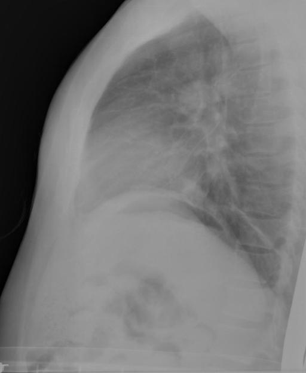

# chexbench_openi_0015
Ordinal 254; source OpenI; stopped-prefix record.

Which finding is in this chest X-ray?

## Complete options

- **A**: right base pulmonary atelectasis
- **B**: left base pulmonary atelectasis

## Original images

Explicit answer: **A. right base pulmonary atelectasis**; reference: **B**; correct: **False**.

Three independent models (medgemma, chest_xray_expert, llava_rad) consistently identify atelectasis at the right lung base on this lateral chest X-ray.

[Prediction](../../evidence/chexbench/predictions/M43-IM-GT-S50-CXR6/chexbench_openi_0015.json) · [own post-prediction feedback](../../evidence/chexbench/feedback/chexbench_openi_0015.json) · [exact context and Skill version](../../evidence/chexbench/contexts/chexbench_openi_0015.json) · [all main requests/responses](../../evidence/chexbench/services/calls/R50-AGENT/chexbench_openi_0015)

## Tool requests and observations

- medgemma: status=completed; [selection](../../evidence/chexbench/services/tool_selections/R50-AGENT/chexbench_openi_0015/1.json), [full request/result/stdout/stderr artifacts](../../evidence/chexbench/services/tool_cache/f9665c65b789a1a54f87d5daf4784e8b0b2e6f3a92b2d9aa2e74da2aabaa6692).
- chest_xray_expert: status=completed; [selection](../../evidence/chexbench/services/tool_selections/R50-AGENT/chexbench_openi_0015/2.json), [full request/result/stdout/stderr artifacts](../../evidence/chexbench/services/tool_cache/a533fa4f7ef0477b5d0c359461b130a3aa1eb26ee2233b0f51949eca72ffe148).
- llava_rad: status=completed; [selection](../../evidence/chexbench/services/tool_selections/R50-AGENT/chexbench_openi_0015/3.json), [full request/result/stdout/stderr artifacts](../../evidence/chexbench/services/tool_cache/852b351b81c9f7c16b01a3156bec3936b64853e8b4720c4d3a81b6769fce47f4).

## Skill and prior-image provenance

Selected IDs: []; prior same-image IDs: [].

This is dataset-label scoring and model/tool narrative, not clinical adjudication or Skill causal verification.
