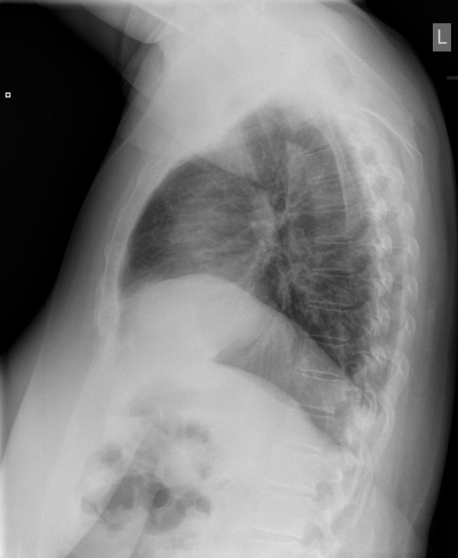

# chexbench_openi_0016
Ordinal 255; source OpenI; stopped-prefix record.

Which finding is in this chest X-ray?

## Complete options

- **A**: elevated right diaphragm
- **B**: elevated left diaphragm

## Original images

Explicit answer: **A. elevated right diaphragm**; reference: **A**; correct: **True**.

Both medgemma and chest_xray_expert independently identified the right hemidiaphragm as elevated on this lateral chest X-ray.

[Prediction](../../evidence/chexbench/predictions/M43-IM-GT-S50-CXR6/chexbench_openi_0016.json) · [own post-prediction feedback](../../evidence/chexbench/feedback/chexbench_openi_0016.json) · [exact context and Skill version](../../evidence/chexbench/contexts/chexbench_openi_0016.json) · [all main requests/responses](../../evidence/chexbench/services/calls/R50-AGENT/chexbench_openi_0016)

## Tool requests and observations

- medgemma: status=completed; [selection](../../evidence/chexbench/services/tool_selections/R50-AGENT/chexbench_openi_0016/1.json), [full request/result/stdout/stderr artifacts](../../evidence/chexbench/services/tool_cache/eda7ce33135798c36b92c0b34ab921b3df1bd5a8708f0ee1b9c1a3b71c7e3686).
- chest_xray_expert: status=completed; [selection](../../evidence/chexbench/services/tool_selections/R50-AGENT/chexbench_openi_0016/2.json), [full request/result/stdout/stderr artifacts](../../evidence/chexbench/services/tool_cache/2510ccc94772307b589495e6bb0afd335c0a3bf16bf73f2f260ec4fb0f8dace4).

## Skill and prior-image provenance

Selected IDs: []; prior same-image IDs: [].

This is dataset-label scoring and model/tool narrative, not clinical adjudication or Skill causal verification.
