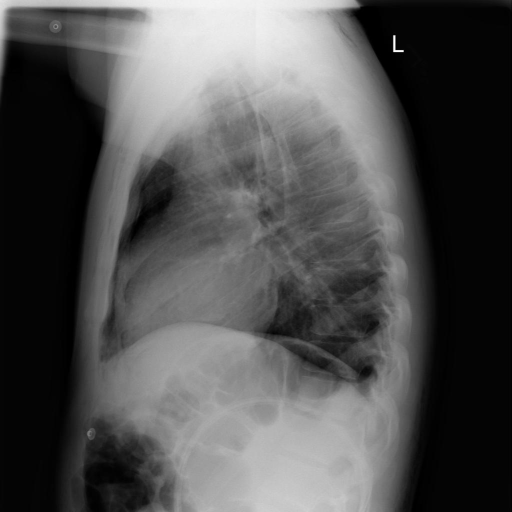

# chexbench_openi_0017
Ordinal 256; source OpenI; stopped-prefix record.

Which finding is in this chest X-ray?

## Complete options

- **A**: surgical instruments in the right lung
- **B**: surgical instruments in the left lung

## Original images

Explicit answer: **A. surgical instruments in the right lung**; reference: **A**; correct: **True**.

Visual inspection confirms a linear radiopaque foreign body consistent with surgical instrumentation projecting over the right hemithorax, despite negative automated tool outputs.

[Prediction](../../evidence/chexbench/predictions/M43-IM-GT-S50-CXR6/chexbench_openi_0017.json) · [own post-prediction feedback](../../evidence/chexbench/feedback/chexbench_openi_0017.json) · [exact context and Skill version](../../evidence/chexbench/contexts/chexbench_openi_0017.json) · [all main requests/responses](../../evidence/chexbench/services/calls/R50-AGENT/chexbench_openi_0017)

## Tool requests and observations

- medgemma: status=completed; [selection](../../evidence/chexbench/services/tool_selections/R50-AGENT/chexbench_openi_0017/1.json), [full request/result/stdout/stderr artifacts](../../evidence/chexbench/services/tool_cache/3999ef6a981871d5a7213324235b0cae4c1c9e1251f6fee23146b8096674bf55).
- chest_xray_expert: status=completed; [selection](../../evidence/chexbench/services/tool_selections/R50-AGENT/chexbench_openi_0017/2.json), [full request/result/stdout/stderr artifacts](../../evidence/chexbench/services/tool_cache/5d4db6bdea326b46127c0a06fb57d10f3be99503021b9cc845cdb6d37dbc868c).
- llava_rad: status=completed; [selection](../../evidence/chexbench/services/tool_selections/R50-AGENT/chexbench_openi_0017/3.json), [full request/result/stdout/stderr artifacts](../../evidence/chexbench/services/tool_cache/8cf751d7946a4f2fb8034c258b661f3f919cb682ed8f42a1077675dbc7d2816f).
- xray_phrase_grounding: status=completed; [selection](../../evidence/chexbench/services/tool_selections/R50-AGENT/chexbench_openi_0017/4.json), [full request/result/stdout/stderr artifacts](../../evidence/chexbench/services/tool_cache/03f063400b0365f1f199a354c2b45ed969ee0e37ccf9f4876406e8254f7c9bd7).

## Skill and prior-image provenance

Selected IDs: []; prior same-image IDs: [].

This is dataset-label scoring and model/tool narrative, not clinical adjudication or Skill causal verification.
