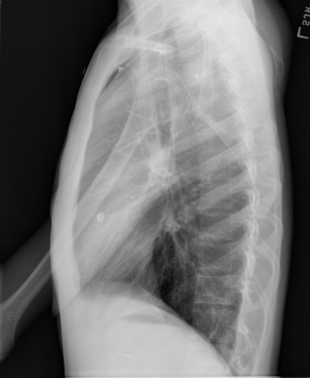

# chexbench_openi_0018
Ordinal 257; source OpenI; stopped-prefix record.

Which finding is in this chest X-ray?

## Complete options

- **A**: right indwelling catheter
- **B**: left indwelling catheter

## Original images

Explicit answer: **A. right indwelling catheter**; reference: **B**; correct: **False**.

Multiple independent visual models (medgemma, llava_med_qa) identified a right-sided indwelling catheter, while others failed to detect or specify laterality; no model reported a left catheter.

[Prediction](../../evidence/chexbench/predictions/M43-IM-GT-S50-CXR6/chexbench_openi_0018.json) · [own post-prediction feedback](../../evidence/chexbench/feedback/chexbench_openi_0018.json) · [exact context and Skill version](../../evidence/chexbench/contexts/chexbench_openi_0018.json) · [all main requests/responses](../../evidence/chexbench/services/calls/R50-AGENT/chexbench_openi_0018)

## Tool requests and observations

- medgemma: status=completed; [selection](../../evidence/chexbench/services/tool_selections/R50-AGENT/chexbench_openi_0018/1.json), [full request/result/stdout/stderr artifacts](../../evidence/chexbench/services/tool_cache/ce7e36b3df25a39b873f44ac9e7db9cf09ceb8c101e81f311fe415ae7dbf36b8).
- chest_xray_expert: status=completed; [selection](../../evidence/chexbench/services/tool_selections/R50-AGENT/chexbench_openi_0018/2.json), [full request/result/stdout/stderr artifacts](../../evidence/chexbench/services/tool_cache/df9bc22fb39f874d681ca38c11a90d9b4e10f48415c65a5f623da700f3cef35f).
- xray_phrase_grounding: status=completed; [selection](../../evidence/chexbench/services/tool_selections/R50-AGENT/chexbench_openi_0018/3.json), [full request/result/stdout/stderr artifacts](../../evidence/chexbench/services/tool_cache/ca5d4024b16adaff4112ec6382e26a520bae19185ec9542e961e4cd7f3379ba2).
- llava_rad: status=completed; [selection](../../evidence/chexbench/services/tool_selections/R50-AGENT/chexbench_openi_0018/4.json), [full request/result/stdout/stderr artifacts](../../evidence/chexbench/services/tool_cache/e5d1a1bf8e8683ab2798f6601936ac8efc60cb7f8a49c2216b7ad86bc7431787).
- medvlm_r1: status=completed; [selection](../../evidence/chexbench/services/tool_selections/R50-AGENT/chexbench_openi_0018/5.json), [full request/result/stdout/stderr artifacts](../../evidence/chexbench/services/tool_cache/27af368533a7dee1c1b44443c980c0c33b5ddf8c3c62c39ad62940214addfeb4).
- llava_med_qa: status=completed; [selection](../../evidence/chexbench/services/tool_selections/R50-AGENT/chexbench_openi_0018/6.json), [full request/result/stdout/stderr artifacts](../../evidence/chexbench/services/tool_cache/c80e7938d746cda43de18e32bf27f06dd3991ec28270c001a32385f62f44ee0d).

## Skill and prior-image provenance

Selected IDs: []; prior same-image IDs: [].

This is dataset-label scoring and model/tool narrative, not clinical adjudication or Skill causal verification.
