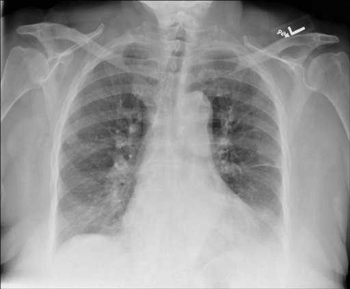
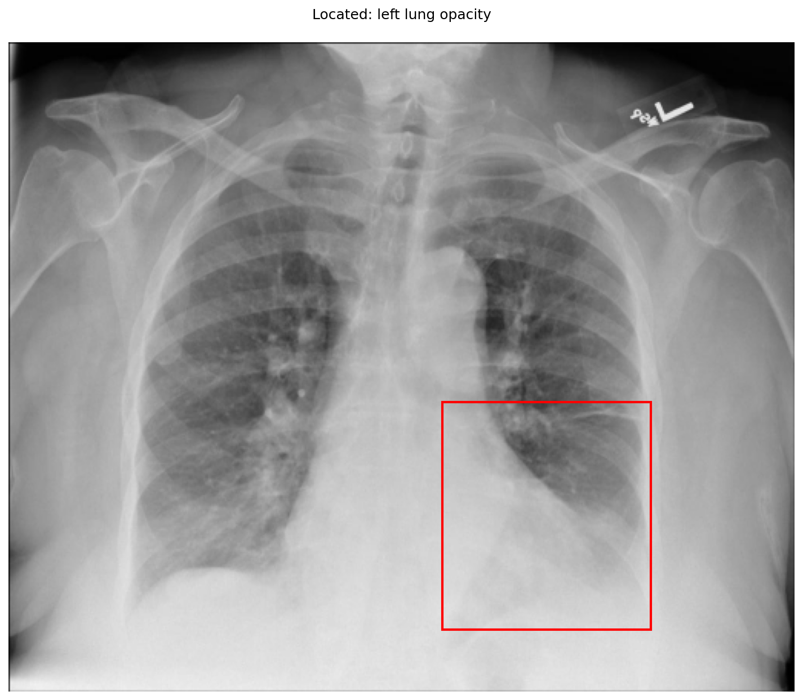
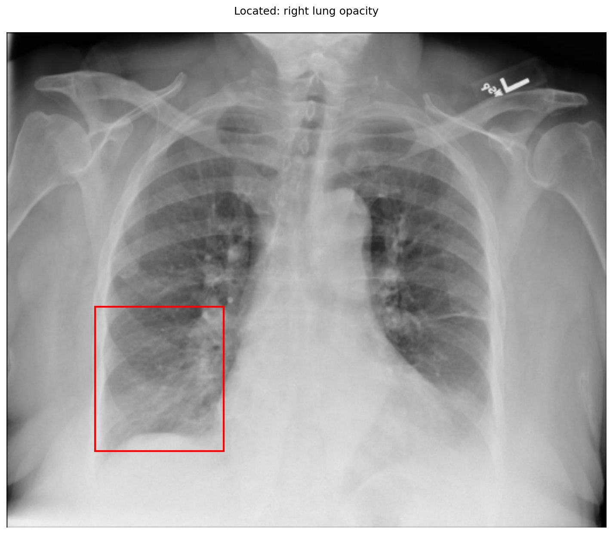

# chexbench_openi_0019
Ordinal 258; source OpenI; stopped-prefix record.

Which finding is in this chest X-ray?

## Complete options

- **A**: left lung opacity
- **B**: right lung opacity

## Original images

Explicit answer: **A. left lung opacity**; reference: **A**; correct: **True**.

Grounding visualization confirms increased density/opacity in the left lower lung zone (patient's left, image right), while the right lung appears relatively clear.

[Prediction](../../evidence/chexbench/predictions/M43-IM-GT-S50-CXR6/chexbench_openi_0019.json) · [own post-prediction feedback](../../evidence/chexbench/feedback/chexbench_openi_0019.json) · [exact context and Skill version](../../evidence/chexbench/contexts/chexbench_openi_0019.json) · [all main requests/responses](../../evidence/chexbench/services/calls/R50-AGENT/chexbench_openi_0019)

## Tool requests and observations

- xray_phrase_grounding: status=completed; [selection](../../evidence/chexbench/services/tool_selections/R50-AGENT/chexbench_openi_0019/1.json), [full request/result/stdout/stderr artifacts](../../evidence/chexbench/services/tool_cache/cd7132f525c0d3fd4a904391df3d602516b922c868abc60856875bc661d764ed).

- xray_phrase_grounding: status=completed; [selection](../../evidence/chexbench/services/tool_selections/R50-AGENT/chexbench_openi_0019/2.json), [full request/result/stdout/stderr artifacts](../../evidence/chexbench/services/tool_cache/e01cbb6b3bea678e7e0a0b5c7983b5346f2d9b8a35e6b04b62fb6c7eb236052f).

## Skill and prior-image provenance

Selected IDs: []; prior same-image IDs: [].

This is dataset-label scoring and model/tool narrative, not clinical adjudication or Skill causal verification.
