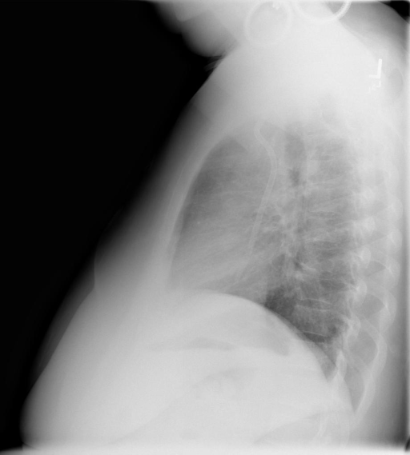

# chexbench_openi_0020
Ordinal 259; source OpenI; stopped-prefix record.

Which finding is in this chest X-ray?

## Complete options

- **A**: right indwelling catheter
- **B**: left indwelling catheter

## Original images

Explicit answer: **B. left indwelling catheter**; reference: **B**; correct: **True**.

The chest_xray_expert model identified the finding as a left indwelling catheter.

[Prediction](../../evidence/chexbench/predictions/M43-IM-GT-S50-CXR6/chexbench_openi_0020.json) · [own post-prediction feedback](../../evidence/chexbench/feedback/chexbench_openi_0020.json) · [exact context and Skill version](../../evidence/chexbench/contexts/chexbench_openi_0020.json) · [all main requests/responses](../../evidence/chexbench/services/calls/R50-AGENT/chexbench_openi_0020)

## Tool requests and observations

- xray_phrase_grounding: status=completed; [selection](../../evidence/chexbench/services/tool_selections/R50-AGENT/chexbench_openi_0020/1.json), [full request/result/stdout/stderr artifacts](../../evidence/chexbench/services/tool_cache/6ebe382d99a44f6ac51166328a0a3e0679a72d8f0c2f001f30171ec4c9f4a0b7).
- chest_xray_expert: status=completed; [selection](../../evidence/chexbench/services/tool_selections/R50-AGENT/chexbench_openi_0020/2.json), [full request/result/stdout/stderr artifacts](../../evidence/chexbench/services/tool_cache/447c0fe7a2591fe4a0f60d4acbd2fee35f07347c945458fc3a4604a652b147eb).

## Skill and prior-image provenance

Selected IDs: []; prior same-image IDs: [].

This is dataset-label scoring and model/tool narrative, not clinical adjudication or Skill causal verification.
