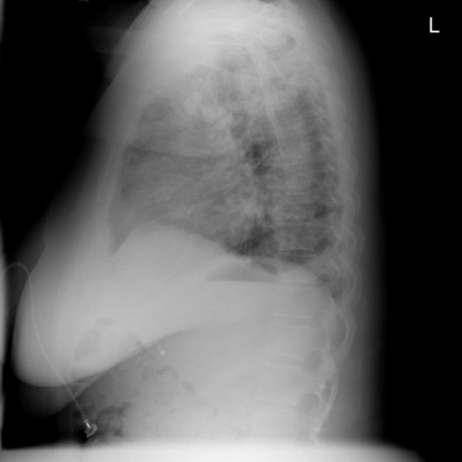
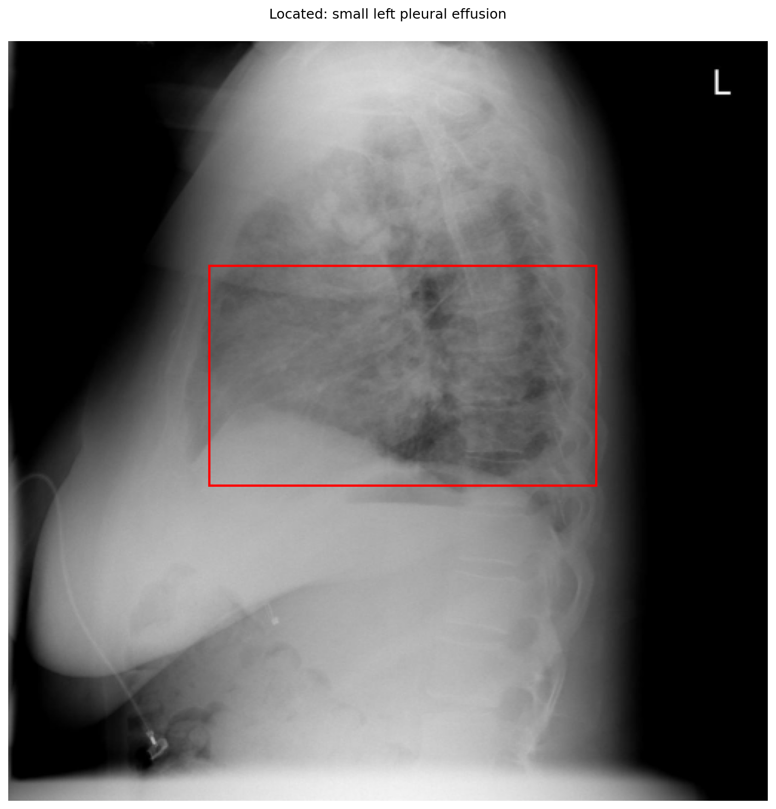
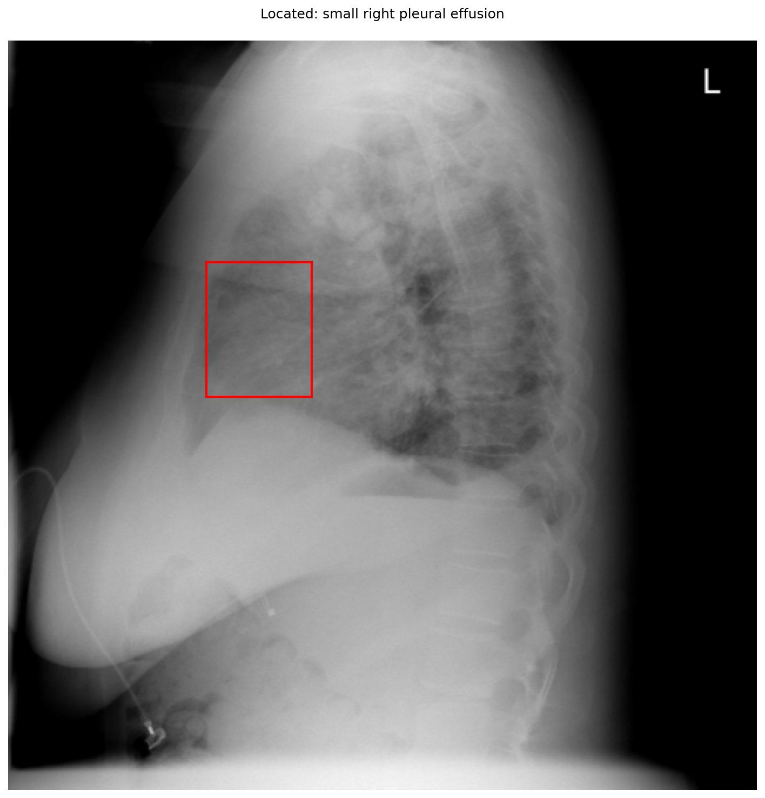

# chexbench_openi_0021
Ordinal 260; source OpenI; stopped-prefix record.

Which finding is in this chest X-ray?

## Complete options

- **A**: small left pleural effusion
- **B**: small right pleural effusion

## Original images

Explicit answer: **A. small left pleural effusion**; reference: **B**; correct: **False**.

Multiple models and phrase grounding localize blunting of the posterior costophrenic angle to the left hemithorax, consistent with a small left pleural effusion.

[Prediction](../../evidence/chexbench/predictions/M43-IM-GT-S50-CXR6/chexbench_openi_0021.json) · [own post-prediction feedback](../../evidence/chexbench/feedback/chexbench_openi_0021.json) · [exact context and Skill version](../../evidence/chexbench/contexts/chexbench_openi_0021.json) · [all main requests/responses](../../evidence/chexbench/services/calls/R50-AGENT/chexbench_openi_0021)

## Tool requests and observations

- medgemma: status=completed; [selection](../../evidence/chexbench/services/tool_selections/R50-AGENT/chexbench_openi_0021/1.json), [full request/result/stdout/stderr artifacts](../../evidence/chexbench/services/tool_cache/9bb25d8ef9605d6cc3ca5c1623c09e3a329770fbe37bbfcd1e87f5f0af2e4d37).
- chest_xray_expert: status=completed; [selection](../../evidence/chexbench/services/tool_selections/R50-AGENT/chexbench_openi_0021/2.json), [full request/result/stdout/stderr artifacts](../../evidence/chexbench/services/tool_cache/a93d5b9c72bf2196a64417c0c2a003d2292578fe48b00ce0e62941e3d608504e).
- xray_phrase_grounding: status=completed; [selection](../../evidence/chexbench/services/tool_selections/R50-AGENT/chexbench_openi_0021/3.json), [full request/result/stdout/stderr artifacts](../../evidence/chexbench/services/tool_cache/a7efceae2e48c758c192023f1820929430e3315aead7962b3dbf92d89e23f07a).

- xray_phrase_grounding: status=completed; [selection](../../evidence/chexbench/services/tool_selections/R50-AGENT/chexbench_openi_0021/4.json), [full request/result/stdout/stderr artifacts](../../evidence/chexbench/services/tool_cache/d9345b1ac9273ebe7a8b0d777cc9fcea03bb86eee621530a6c1616806facdb0d).

## Skill and prior-image provenance

Selected IDs: []; prior same-image IDs: [].

This is dataset-label scoring and model/tool narrative, not clinical adjudication or Skill causal verification.
