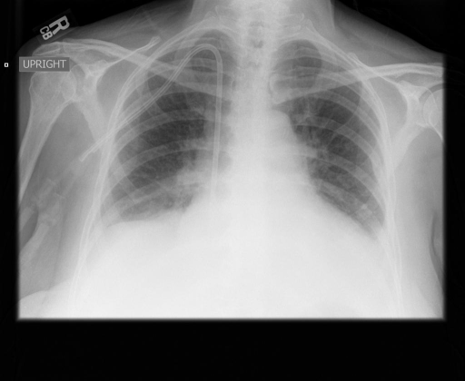
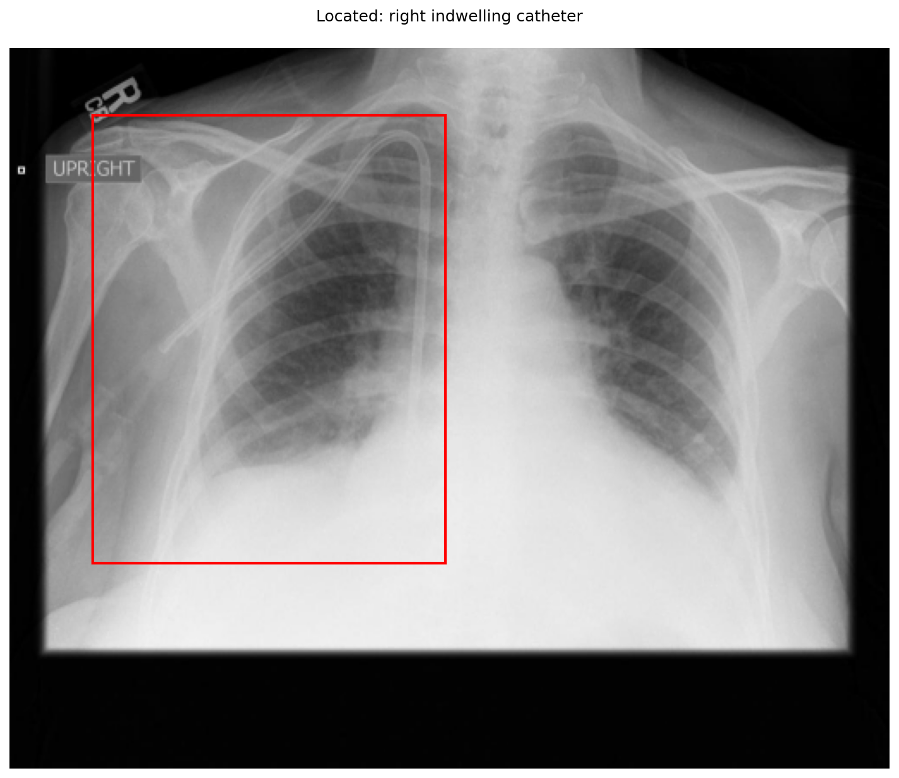
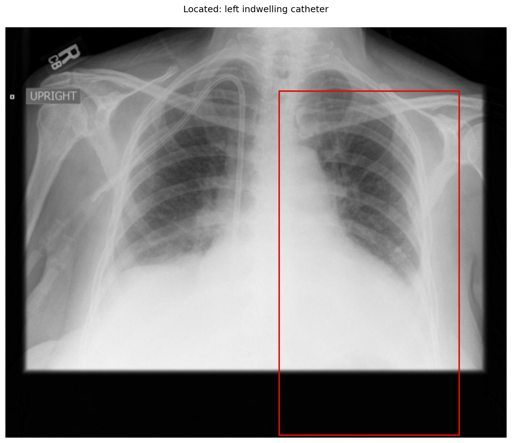

# chexbench_openi_0022
Ordinal 261; source OpenI; stopped-prefix record.

Which finding is in this chest X-ray?

## Complete options

- **A**: right indwelling catheter
- **B**: left indwelling catheter

## Original images

Explicit answer: **A. right indwelling catheter**; reference: **A**; correct: **True**.

The grounding visualization confirms a catheter line is present on the patient's right side (image left), while the left side box highlights empty lung field.

[Prediction](../../evidence/chexbench/predictions/M43-IM-GT-S50-CXR6/chexbench_openi_0022.json) · [own post-prediction feedback](../../evidence/chexbench/feedback/chexbench_openi_0022.json) · [exact context and Skill version](../../evidence/chexbench/contexts/chexbench_openi_0022.json) · [all main requests/responses](../../evidence/chexbench/services/calls/R50-AGENT/chexbench_openi_0022)

## Tool requests and observations

- xray_phrase_grounding: status=completed; [selection](../../evidence/chexbench/services/tool_selections/R50-AGENT/chexbench_openi_0022/1.json), [full request/result/stdout/stderr artifacts](../../evidence/chexbench/services/tool_cache/bfe536f0f1d97350a193377db7a49272c59bb32535f303aac3de7bb6ee0bac01).

- xray_phrase_grounding: status=completed; [selection](../../evidence/chexbench/services/tool_selections/R50-AGENT/chexbench_openi_0022/2.json), [full request/result/stdout/stderr artifacts](../../evidence/chexbench/services/tool_cache/ce29f4cd8a064d5dd1e69c73226baeef6e101207b86627e39bdae78a03d79123).

## Skill and prior-image provenance

Selected IDs: []; prior same-image IDs: [].

This is dataset-label scoring and model/tool narrative, not clinical adjudication or Skill causal verification.
