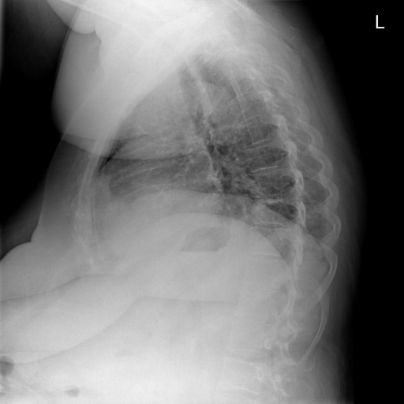

# chexbench_openi_0023
Ordinal 262; source OpenI; stopped-prefix record.

Which finding is in this chest X-ray?

## Complete options

- **A**: left base pulmonary atelectasis
- **B**: right base pulmonary atelectasis

## Original images

Explicit answer: **A. left base pulmonary atelectasis**; reference: **A**; correct: **True**.

Three independent VLMs (medgemma, chest_xray_expert, llava_rad) consistently identified left base pulmonary atelectasis, while grounding failed for both sides likely due to lateral view limitations.

[Prediction](../../evidence/chexbench/predictions/M43-IM-GT-S50-CXR6/chexbench_openi_0023.json) · [own post-prediction feedback](../../evidence/chexbench/feedback/chexbench_openi_0023.json) · [exact context and Skill version](../../evidence/chexbench/contexts/chexbench_openi_0023.json) · [all main requests/responses](../../evidence/chexbench/services/calls/R50-AGENT/chexbench_openi_0023)

## Tool requests and observations

- medgemma: status=completed; [selection](../../evidence/chexbench/services/tool_selections/R50-AGENT/chexbench_openi_0023/1.json), [full request/result/stdout/stderr artifacts](../../evidence/chexbench/services/tool_cache/a8ece455599a8858cf2722c784c938ec46ffbf352feb286967a794fca80acad0).
- chest_xray_expert: status=completed; [selection](../../evidence/chexbench/services/tool_selections/R50-AGENT/chexbench_openi_0023/2.json), [full request/result/stdout/stderr artifacts](../../evidence/chexbench/services/tool_cache/db9a9368f52ec00eb1fad61525e27e7e3924f087b8400f722e816836d235445d).
- xray_phrase_grounding: status=completed; [selection](../../evidence/chexbench/services/tool_selections/R50-AGENT/chexbench_openi_0023/3.json), [full request/result/stdout/stderr artifacts](../../evidence/chexbench/services/tool_cache/9f36b12d6902455477706fb90412712019a169f0339f43ffacdeb6074f4b3eb0).
- xray_phrase_grounding: status=completed; [selection](../../evidence/chexbench/services/tool_selections/R50-AGENT/chexbench_openi_0023/4.json), [full request/result/stdout/stderr artifacts](../../evidence/chexbench/services/tool_cache/1e35de3b8b8069a653d2588bc70d2fdaef6cfc3b00fce8137141afb82fbc0b3e).
- llava_rad: status=completed; [selection](../../evidence/chexbench/services/tool_selections/R50-AGENT/chexbench_openi_0023/5.json), [full request/result/stdout/stderr artifacts](../../evidence/chexbench/services/tool_cache/d8bf38c1c6e0cd8306c8d126745e80b5f4544c5b6b25af16d0f861d4ab65f4d8).

## Skill and prior-image provenance

Selected IDs: []; prior same-image IDs: [].

This is dataset-label scoring and model/tool narrative, not clinical adjudication or Skill causal verification.
