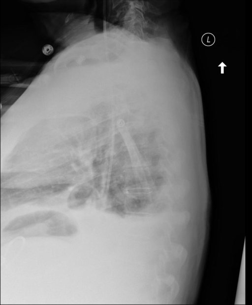
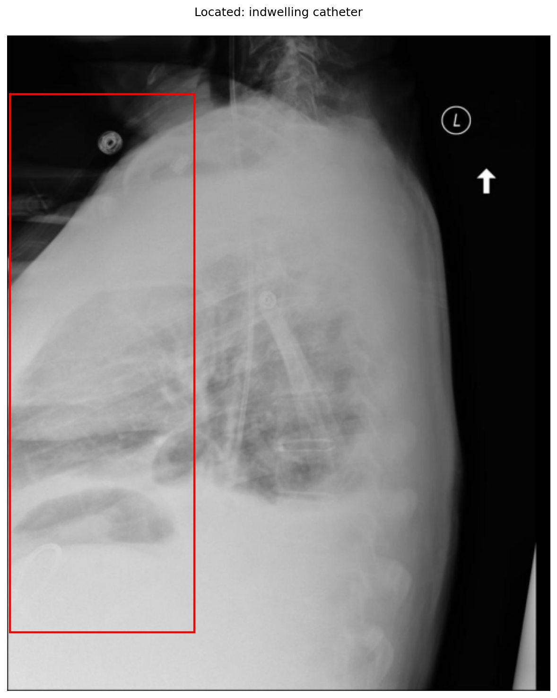

# chexbench_openi_0024
Ordinal 263; source OpenI; stopped-prefix record.

Which finding is in this chest X-ray?

## Complete options

- **A**: left indwelling catheter
- **B**: right indwelling catheter

## Original images

Explicit answer: **B. right indwelling catheter**; reference: **A**; correct: **False**.

The chest_xray_expert model explicitly identified the indwelling catheter as being on the right side in this lateral chest X-ray.

[Prediction](../../evidence/chexbench/predictions/M43-IM-GT-S50-CXR6/chexbench_openi_0024.json) · [own post-prediction feedback](../../evidence/chexbench/feedback/chexbench_openi_0024.json) · [exact context and Skill version](../../evidence/chexbench/contexts/chexbench_openi_0024.json) · [all main requests/responses](../../evidence/chexbench/services/calls/R50-AGENT/chexbench_openi_0024)

## Tool requests and observations

- xray_phrase_grounding: status=completed; [selection](../../evidence/chexbench/services/tool_selections/R50-AGENT/chexbench_openi_0024/1.json), [full request/result/stdout/stderr artifacts](../../evidence/chexbench/services/tool_cache/63fbd2790b71901c0f1ee0f1ff5cab1048163c3ec3be82271619b27874050338).

- chest_xray_expert: status=completed; [selection](../../evidence/chexbench/services/tool_selections/R50-AGENT/chexbench_openi_0024/2.json), [full request/result/stdout/stderr artifacts](../../evidence/chexbench/services/tool_cache/8b740e71ff0fe648a753ae28569cc13313e3dfe624eb35508b9625f149bb3486).
- chest_xray_expert: status=completed; [selection](../../evidence/chexbench/services/tool_selections/R50-AGENT/chexbench_openi_0024/3.json), [full request/result/stdout/stderr artifacts](../../evidence/chexbench/services/tool_cache/7ec30181a8696a1b7aa25a983935518ff6354a0952a0698824fb6641a41a8b28).

## Skill and prior-image provenance

Selected IDs: []; prior same-image IDs: [].

This is dataset-label scoring and model/tool narrative, not clinical adjudication or Skill causal verification.
