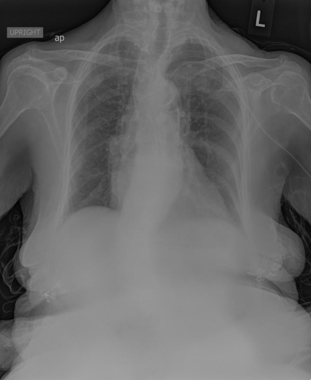
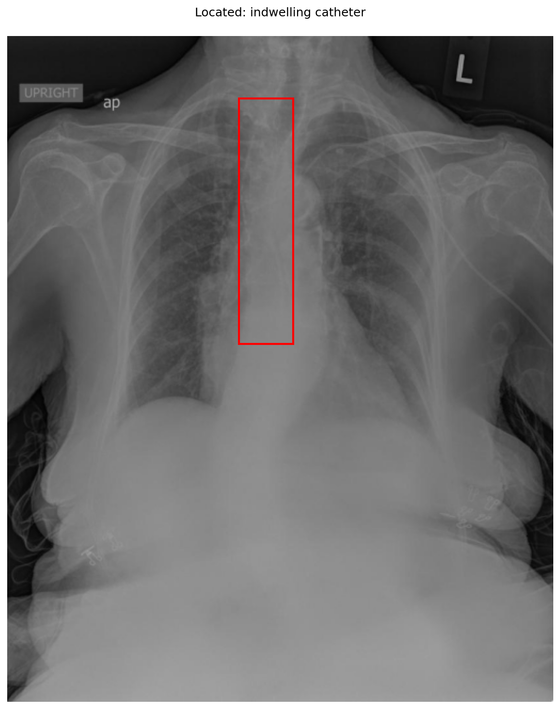

# chexbench_openi_0025
Ordinal 264; source OpenI; stopped-prefix record.

Which finding is in this chest X-ray?

## Complete options

- **A**: right indwelling catheter
- **B**: left indwelling catheter

## Original images

Explicit answer: **B. left indwelling catheter**; reference: **B**; correct: **True**.

The grounding box is centered in the upper mediastinum and a linear radiopaque catheter is visible entering from the patient's left side (marked with 'L'), consistent with a left-sided indwelling catheter.

[Prediction](../../evidence/chexbench/predictions/M43-IM-GT-S50-CXR6/chexbench_openi_0025.json) · [own post-prediction feedback](../../evidence/chexbench/feedback/chexbench_openi_0025.json) · [exact context and Skill version](../../evidence/chexbench/contexts/chexbench_openi_0025.json) · [all main requests/responses](../../evidence/chexbench/services/calls/R50-AGENT/chexbench_openi_0025)

## Tool requests and observations

- xray_phrase_grounding: status=completed; [selection](../../evidence/chexbench/services/tool_selections/R50-AGENT/chexbench_openi_0025/1.json), [full request/result/stdout/stderr artifacts](../../evidence/chexbench/services/tool_cache/fb17fdda2ffaf9d50e8aac67954a2ac29c10bb9e3301d2cd37d8178bcfb79e49).

## Skill and prior-image provenance

Selected IDs: []; prior same-image IDs: ['chexbench_rad_restruct_0220'].

This is dataset-label scoring and model/tool narrative, not clinical adjudication or Skill causal verification.
