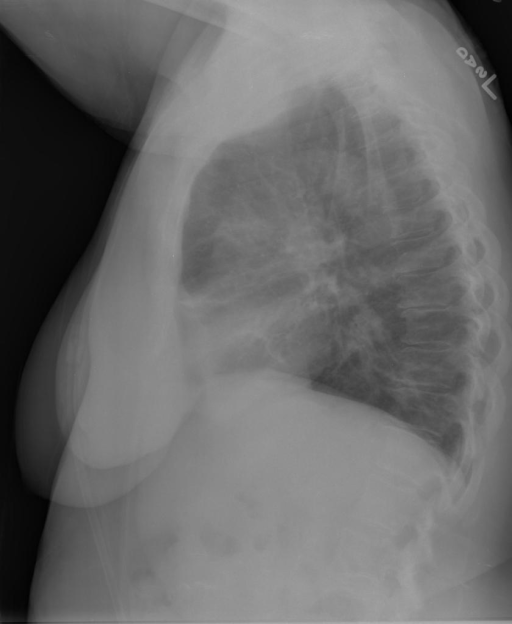
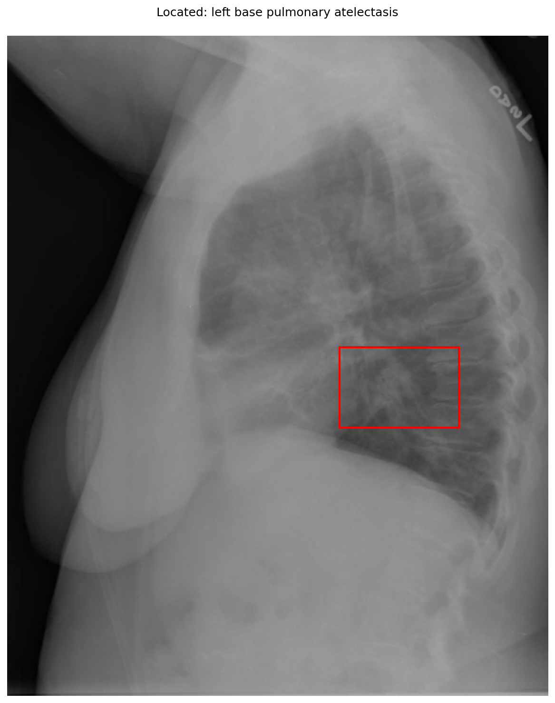

# chexbench_openi_0026
Ordinal 265; source OpenI; stopped-prefix record.

Which finding is in this chest X-ray?

## Complete options

- **A**: left base pulmonary atelectasis
- **B**: right base pulmonary atelectasis

## Original images

Explicit answer: **A. left base pulmonary atelectasis**; reference: **A**; correct: **True**.

Phrase grounding visually localized left base pulmonary atelectasis in the posterior lower lung zone, consistent with lateral view findings.

[Prediction](../../evidence/chexbench/predictions/M43-IM-GT-S50-CXR6/chexbench_openi_0026.json) · [own post-prediction feedback](../../evidence/chexbench/feedback/chexbench_openi_0026.json) · [exact context and Skill version](../../evidence/chexbench/contexts/chexbench_openi_0026.json) · [all main requests/responses](../../evidence/chexbench/services/calls/R50-AGENT/chexbench_openi_0026)

## Tool requests and observations

- medgemma: status=completed; [selection](../../evidence/chexbench/services/tool_selections/R50-AGENT/chexbench_openi_0026/1.json), [full request/result/stdout/stderr artifacts](../../evidence/chexbench/services/tool_cache/1c9394267d6a0bac43f579ca1f83dcf8e7d9d8368342da860b923f6619e47a5f).
- chest_xray_expert: status=completed; [selection](../../evidence/chexbench/services/tool_selections/R50-AGENT/chexbench_openi_0026/2.json), [full request/result/stdout/stderr artifacts](../../evidence/chexbench/services/tool_cache/e5d1a945b1be214936ef7d3c527bb3cd4d37ab57bf8b325c723ea63a1c5108fb).
- xray_phrase_grounding: status=completed; [selection](../../evidence/chexbench/services/tool_selections/R50-AGENT/chexbench_openi_0026/3.json), [full request/result/stdout/stderr artifacts](../../evidence/chexbench/services/tool_cache/9c946d6763cda29b680db3333e700f5709178000581a9767c21a04028b116a01).

## Skill and prior-image provenance

Selected IDs: []; prior same-image IDs: [].

This is dataset-label scoring and model/tool narrative, not clinical adjudication or Skill causal verification.
