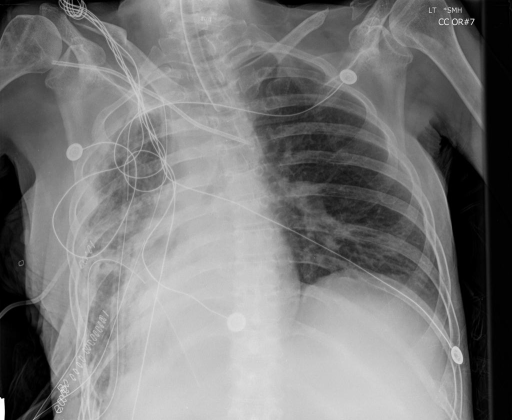

# chexbench_openi_0027
Ordinal 266; source OpenI; stopped-prefix record.

Which finding is in this chest X-ray?

## Complete options

- **A**: left pleural effusion
- **B**: right pleural effusion

## Original images

Explicit answer: **B. right pleural effusion**; reference: **A**; correct: **False**.

Both medgemma and chest_xray_expert identify significant opacification of the right hemithorax consistent with a right pleural effusion, while the left lung field appears relatively clear.

[Prediction](../../evidence/chexbench/predictions/M43-IM-GT-S50-CXR6/chexbench_openi_0027.json) · [own post-prediction feedback](../../evidence/chexbench/feedback/chexbench_openi_0027.json) · [exact context and Skill version](../../evidence/chexbench/contexts/chexbench_openi_0027.json) · [all main requests/responses](../../evidence/chexbench/services/calls/R50-AGENT/chexbench_openi_0027)

## Tool requests and observations

- medgemma: status=completed; [selection](../../evidence/chexbench/services/tool_selections/R50-AGENT/chexbench_openi_0027/1.json), [full request/result/stdout/stderr artifacts](../../evidence/chexbench/services/tool_cache/ce890f55af11eeebd2e29f6fac917cc7c4daae0f496b8a64f40e240999c38408).
- chest_xray_expert: status=completed; [selection](../../evidence/chexbench/services/tool_selections/R50-AGENT/chexbench_openi_0027/2.json), [full request/result/stdout/stderr artifacts](../../evidence/chexbench/services/tool_cache/4df2c5952886479e4340800a1df429fbd3d6f097467bc2d0117ad818ce735327).

## Skill and prior-image provenance

Selected IDs: []; prior same-image IDs: [].

This is dataset-label scoring and model/tool narrative, not clinical adjudication or Skill causal verification.
