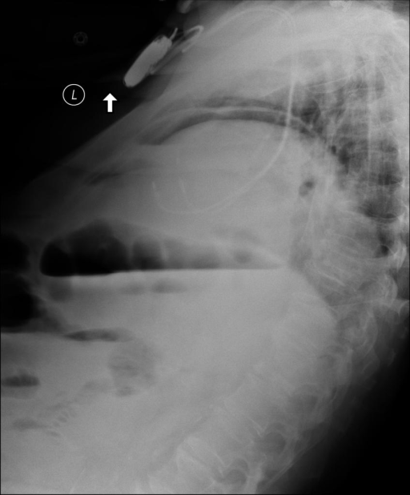

# chexbench_openi_0028
Ordinal 267; source OpenI; stopped-prefix record.

Which finding is in this chest X-ray?

## Complete options

- **A**: left indwelling catheter
- **B**: right indwelling catheter

## Original images

Explicit answer: **B. right indwelling catheter**; reference: **B**; correct: **True**.

The chest_xray_expert tool identified the visible indwelling catheter as being on the right side.

[Prediction](../../evidence/chexbench/predictions/M43-IM-GT-S50-CXR6/chexbench_openi_0028.json) · [own post-prediction feedback](../../evidence/chexbench/feedback/chexbench_openi_0028.json) · [exact context and Skill version](../../evidence/chexbench/contexts/chexbench_openi_0028.json) · [all main requests/responses](../../evidence/chexbench/services/calls/R50-AGENT/chexbench_openi_0028)

## Tool requests and observations

- xray_phrase_grounding: status=completed; [selection](../../evidence/chexbench/services/tool_selections/R50-AGENT/chexbench_openi_0028/1.json), [full request/result/stdout/stderr artifacts](../../evidence/chexbench/services/tool_cache/7cc8c0e87e14ecddf5de8d783930cb7de8ca13315405110fbed6b0e19ae1b543).
- chest_xray_expert: status=completed; [selection](../../evidence/chexbench/services/tool_selections/R50-AGENT/chexbench_openi_0028/2.json), [full request/result/stdout/stderr artifacts](../../evidence/chexbench/services/tool_cache/267b6741c57900ef497992f36dce66df051d5e56376b4e40dac4548f4022de61).

## Skill and prior-image provenance

Selected IDs: []; prior same-image IDs: [].

This is dataset-label scoring and model/tool narrative, not clinical adjudication or Skill causal verification.
