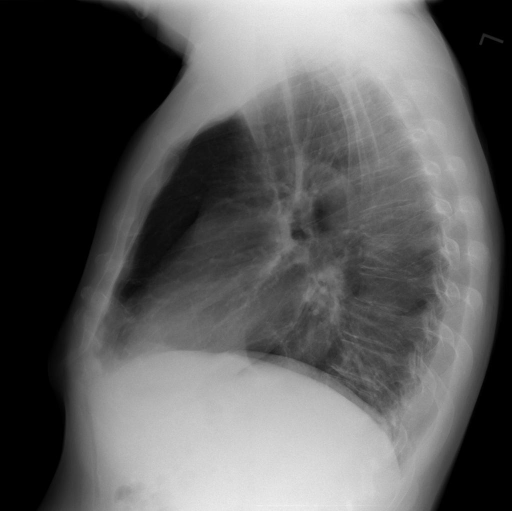
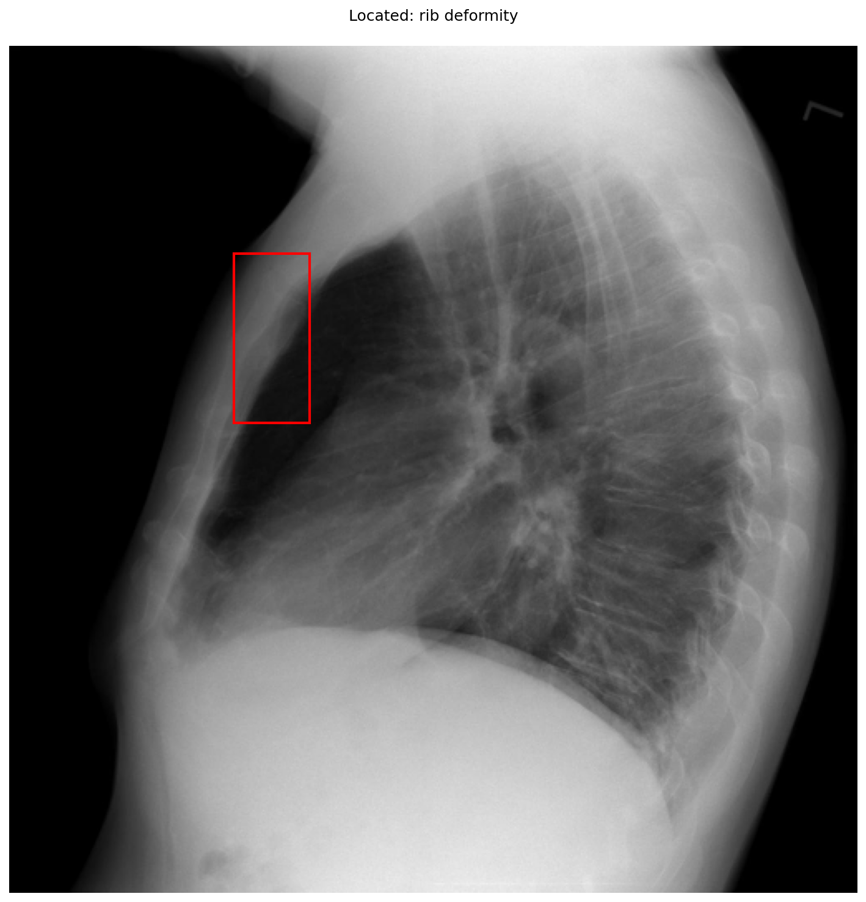

# chexbench_openi_0029
Ordinal 268; source OpenI; stopped-prefix record.

Which finding is in this chest X-ray?

## Complete options

- **A**: left rib deformity
- **B**: right rib deformity

## Original images

Explicit answer: **A. left rib deformity**; reference: **B**; correct: **False**.

The grounding box localizes the deformity to the anterior chest wall on the lateral view, which corresponds to the left ribs given the standard lateral projection orientation and the 'L' marker indicating the left side is facing the detector.

[Prediction](../../evidence/chexbench/predictions/M43-IM-GT-S50-CXR6/chexbench_openi_0029.json) · [own post-prediction feedback](../../evidence/chexbench/feedback/chexbench_openi_0029.json) · [exact context and Skill version](../../evidence/chexbench/contexts/chexbench_openi_0029.json) · [all main requests/responses](../../evidence/chexbench/services/calls/R50-AGENT/chexbench_openi_0029)

## Tool requests and observations

- medgemma: status=completed; [selection](../../evidence/chexbench/services/tool_selections/R50-AGENT/chexbench_openi_0029/1.json), [full request/result/stdout/stderr artifacts](../../evidence/chexbench/services/tool_cache/dc3746dc233eec50e4bb3191bd42450d7c040bec202c51c24d3e0f10f514176b).
- chest_xray_expert: status=completed; [selection](../../evidence/chexbench/services/tool_selections/R50-AGENT/chexbench_openi_0029/2.json), [full request/result/stdout/stderr artifacts](../../evidence/chexbench/services/tool_cache/6fc5468c7d67fc3d24f5df6a49a691c4bceff145a9b886156b08b597eee5ea9e).
- xray_phrase_grounding: status=completed; [selection](../../evidence/chexbench/services/tool_selections/R50-AGENT/chexbench_openi_0029/3.json), [full request/result/stdout/stderr artifacts](../../evidence/chexbench/services/tool_cache/b661f6e027c84d0caf147e1ac889a276f09bf31a6847791844dcfc680c30ff8d).

## Skill and prior-image provenance

Selected IDs: []; prior same-image IDs: [].

This is dataset-label scoring and model/tool narrative, not clinical adjudication or Skill causal verification.
