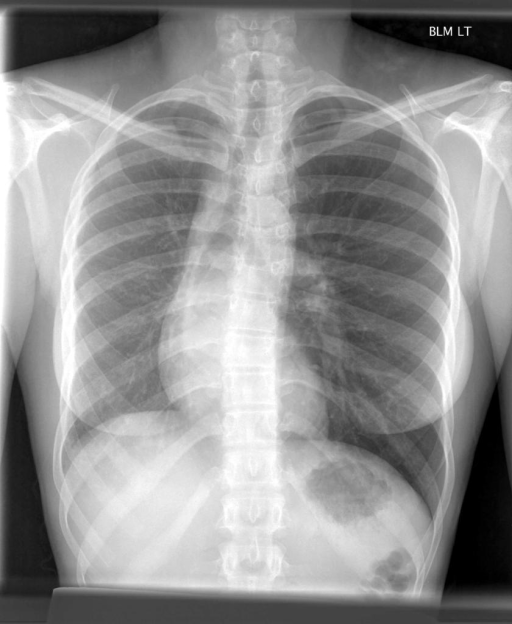
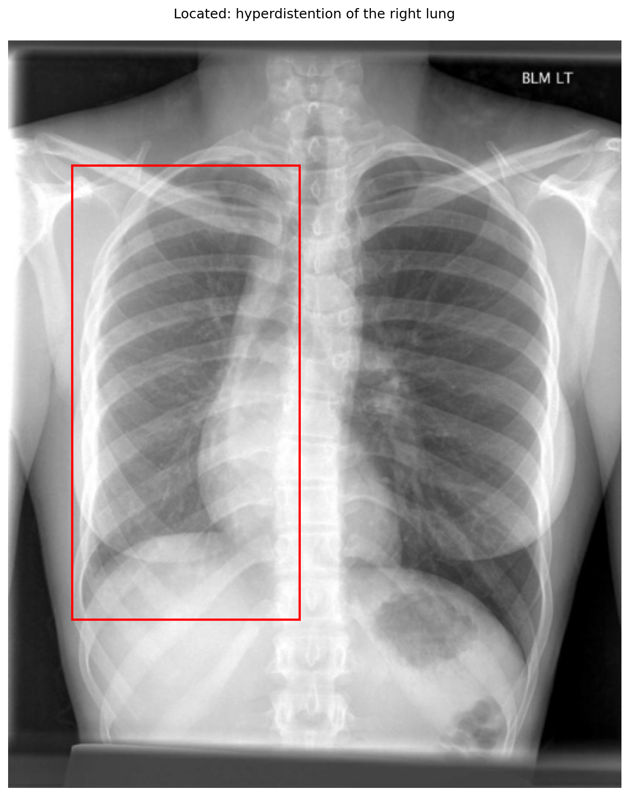

# chexbench_openi_0030
Ordinal 269; source OpenI; stopped-prefix record.

Which finding is in this chest X-ray?

## Complete options

- **A**: hyperdistention of the left lung
- **B**: hyperdistention of the right lung

## Original images

Explicit answer: **B. hyperdistention of the right lung**; reference: **A**; correct: **False**.

Multiple models and phrase grounding confirm increased volume and lucency in the right hemithorax consistent with hyperdistention.

[Prediction](../../evidence/chexbench/predictions/M43-IM-GT-S50-CXR6/chexbench_openi_0030.json) · [own post-prediction feedback](../../evidence/chexbench/feedback/chexbench_openi_0030.json) · [exact context and Skill version](../../evidence/chexbench/contexts/chexbench_openi_0030.json) · [all main requests/responses](../../evidence/chexbench/services/calls/R50-AGENT/chexbench_openi_0030)

## Tool requests and observations

- medgemma: status=completed; [selection](../../evidence/chexbench/services/tool_selections/R50-AGENT/chexbench_openi_0030/1.json), [full request/result/stdout/stderr artifacts](../../evidence/chexbench/services/tool_cache/ccc029f479faf7908ea223ac05bc0df9255efdfb727af3b3f3862bdd119449e1).
- chest_xray_expert: status=completed; [selection](../../evidence/chexbench/services/tool_selections/R50-AGENT/chexbench_openi_0030/2.json), [full request/result/stdout/stderr artifacts](../../evidence/chexbench/services/tool_cache/1c48b73df4f8ad786e969a9a313d4c5e5cda071710276fbb306bf8a4beed3ff7).
- xray_phrase_grounding: status=completed; [selection](../../evidence/chexbench/services/tool_selections/R50-AGENT/chexbench_openi_0030/3.json), [full request/result/stdout/stderr artifacts](../../evidence/chexbench/services/tool_cache/dec8b659f896aa4d4f19fdc31ba809ab4fd15011f584fcd429254166305ff6cf).

## Skill and prior-image provenance

Selected IDs: []; prior same-image IDs: [].

This is dataset-label scoring and model/tool narrative, not clinical adjudication or Skill causal verification.
