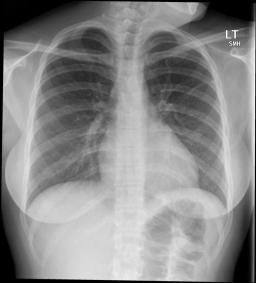

# chexbench_openi_0031
Ordinal 270; source OpenI; stopped-prefix record.

Which finding is in this chest X-ray?

## Complete options

- **A**: mild left lung pulmonary atelectasis
- **B**: mild right lung pulmonary atelectasis

## Original images

Explicit answer: **A. mild left lung pulmonary atelectasis**; reference: **A**; correct: **True**.

Both MedGemma and CheXagent identified findings consistent with mild left lung pulmonary atelectasis.

[Prediction](../../evidence/chexbench/predictions/M43-IM-GT-S50-CXR6/chexbench_openi_0031.json) · [own post-prediction feedback](../../evidence/chexbench/feedback/chexbench_openi_0031.json) · [exact context and Skill version](../../evidence/chexbench/contexts/chexbench_openi_0031.json) · [all main requests/responses](../../evidence/chexbench/services/calls/R50-AGENT/chexbench_openi_0031)

## Tool requests and observations

- medgemma: status=completed; [selection](../../evidence/chexbench/services/tool_selections/R50-AGENT/chexbench_openi_0031/1.json), [full request/result/stdout/stderr artifacts](../../evidence/chexbench/services/tool_cache/0cb926bff16fdf188cca15d13d9e8c112a7f51a3fd54b9695d83cddbdf0df846).
- chest_xray_expert: status=completed; [selection](../../evidence/chexbench/services/tool_selections/R50-AGENT/chexbench_openi_0031/2.json), [full request/result/stdout/stderr artifacts](../../evidence/chexbench/services/tool_cache/3d335a3501d52fe4c6b0ab4520a384f867a05e54f81b06c17f84fb2dbce09a62).

## Skill and prior-image provenance

Selected IDs: []; prior same-image IDs: [].

This is dataset-label scoring and model/tool narrative, not clinical adjudication or Skill causal verification.
