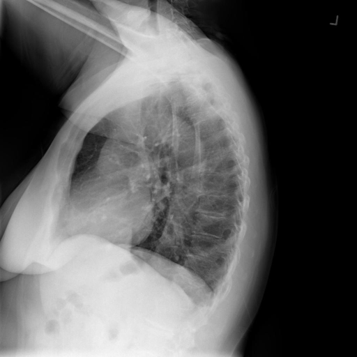

# chexbench_openi_0032
Ordinal 271; source OpenI; stopped-prefix record.

Which finding is in this chest X-ray?

## Complete options

- **A**: right base pulmonary atelectasis
- **B**: left base pulmonary atelectasis

## Original images

Explicit answer: **A. right base pulmonary atelectasis**; reference: **B**; correct: **False**.

MedGemma identified right base atelectasis while other models were negative or incoherent, and grounding failed for both options likely due to subtle findings on lateral view.

[Prediction](../../evidence/chexbench/predictions/M43-IM-GT-S50-CXR6/chexbench_openi_0032.json) · [own post-prediction feedback](../../evidence/chexbench/feedback/chexbench_openi_0032.json) · [exact context and Skill version](../../evidence/chexbench/contexts/chexbench_openi_0032.json) · [all main requests/responses](../../evidence/chexbench/services/calls/R50-AGENT/chexbench_openi_0032)

## Tool requests and observations

- medgemma: status=completed; [selection](../../evidence/chexbench/services/tool_selections/R50-AGENT/chexbench_openi_0032/1.json), [full request/result/stdout/stderr artifacts](../../evidence/chexbench/services/tool_cache/12668b4cfa7dc4060fb0e32fc919ea7cdb4e1d7fa88c8c957b6f9bc6106d5d33).
- chest_xray_expert: status=completed; [selection](../../evidence/chexbench/services/tool_selections/R50-AGENT/chexbench_openi_0032/2.json), [full request/result/stdout/stderr artifacts](../../evidence/chexbench/services/tool_cache/33bf1cc9e03d119c414d874f6248211c063ff4c016d11c1d694ab02326e2d2bc).
- llava_rad: status=completed; [selection](../../evidence/chexbench/services/tool_selections/R50-AGENT/chexbench_openi_0032/3.json), [full request/result/stdout/stderr artifacts](../../evidence/chexbench/services/tool_cache/469d4d5674e0bf6a4ffe5f5dd84afd2605f57cf4b398b662ee78e98acf19269a).
- xray_phrase_grounding: status=completed; [selection](../../evidence/chexbench/services/tool_selections/R50-AGENT/chexbench_openi_0032/4.json), [full request/result/stdout/stderr artifacts](../../evidence/chexbench/services/tool_cache/2034a34382e4cc85fd5733fdedaf3d592dd45d3a3e71a822ac18c63fa0415438).
- xray_phrase_grounding: status=completed; [selection](../../evidence/chexbench/services/tool_selections/R50-AGENT/chexbench_openi_0032/5.json), [full request/result/stdout/stderr artifacts](../../evidence/chexbench/services/tool_cache/121e320c903ff0c9ce7fed0f90ecde9ee2b2c28c19ba636994107eafa6c1fd2a).
- medvlm_r1: status=completed; [selection](../../evidence/chexbench/services/tool_selections/R50-AGENT/chexbench_openi_0032/6.json), [full request/result/stdout/stderr artifacts](../../evidence/chexbench/services/tool_cache/166364378768e4b5678796b0d61fb2a84d369513f79042d6bb8eb098e8730905).

## Skill and prior-image provenance

Selected IDs: []; prior same-image IDs: [].

This is dataset-label scoring and model/tool narrative, not clinical adjudication or Skill causal verification.
