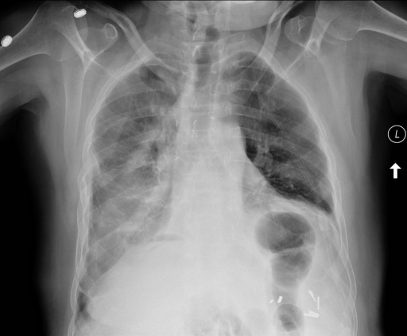
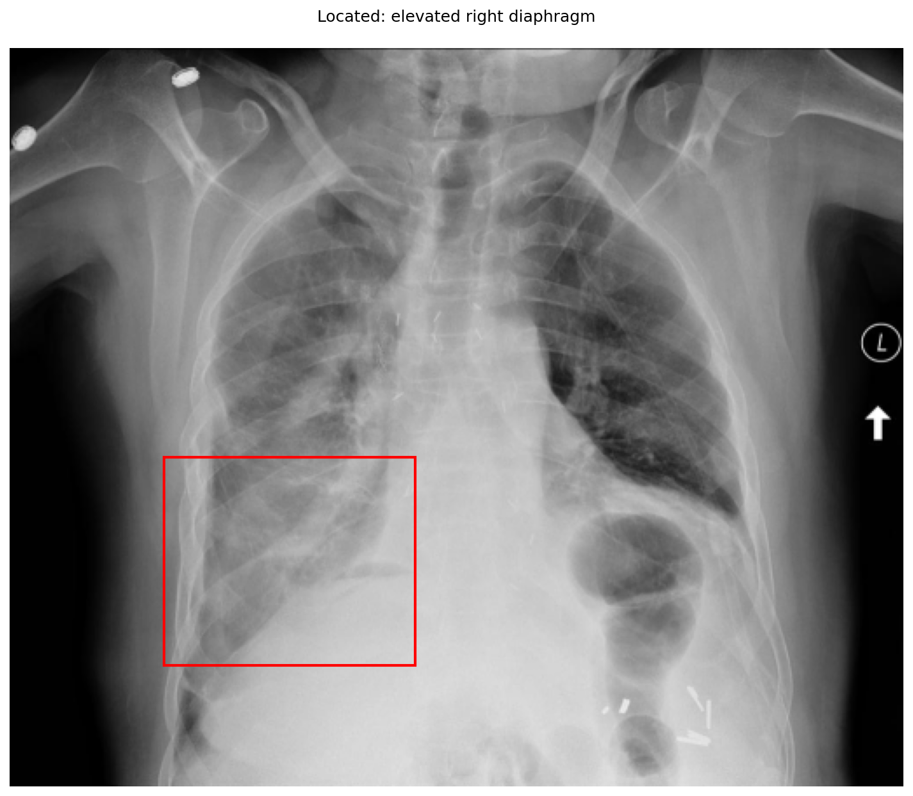
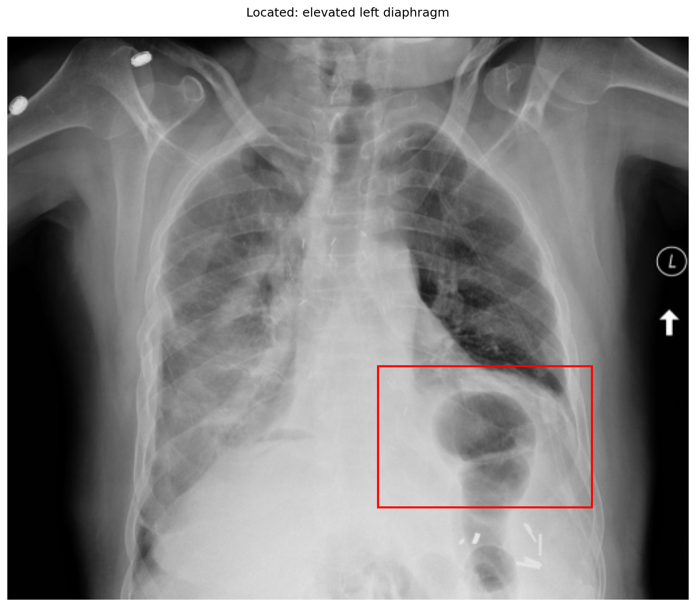

# chexbench_openi_0033
Ordinal 272; source OpenI; stopped-prefix record.

Which finding is in this chest X-ray?

## Complete options

- **A**: elevated right diaphragm
- **B**: elevated left diaphragm

## Original images

Explicit answer: **B. elevated left diaphragm**; reference: **B**; correct: **True**.

The left hemidiaphragm is abnormally high with a prominent gastric bubble beneath it, while the right hemidiaphragm appears at a normal level relative to the ribs.

[Prediction](../../evidence/chexbench/predictions/M43-IM-GT-S50-CXR6/chexbench_openi_0033.json) · [own post-prediction feedback](../../evidence/chexbench/feedback/chexbench_openi_0033.json) · [exact context and Skill version](../../evidence/chexbench/contexts/chexbench_openi_0033.json) · [all main requests/responses](../../evidence/chexbench/services/calls/R50-AGENT/chexbench_openi_0033)

## Tool requests and observations

- xray_phrase_grounding: status=completed; [selection](../../evidence/chexbench/services/tool_selections/R50-AGENT/chexbench_openi_0033/1.json), [full request/result/stdout/stderr artifacts](../../evidence/chexbench/services/tool_cache/42bd49179723ec16d07089cea83d72e85d804a7b6e3ae36138f09a267e341e8e).

- xray_phrase_grounding: status=completed; [selection](../../evidence/chexbench/services/tool_selections/R50-AGENT/chexbench_openi_0033/2.json), [full request/result/stdout/stderr artifacts](../../evidence/chexbench/services/tool_cache/e2675fa1cbc8b935389691efcf473c9442e09ad17f692ed4ce21c454feed7625).

## Skill and prior-image provenance

Selected IDs: []; prior same-image IDs: [].

This is dataset-label scoring and model/tool narrative, not clinical adjudication or Skill causal verification.
