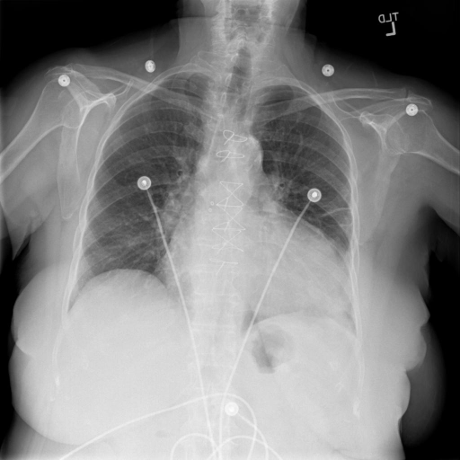
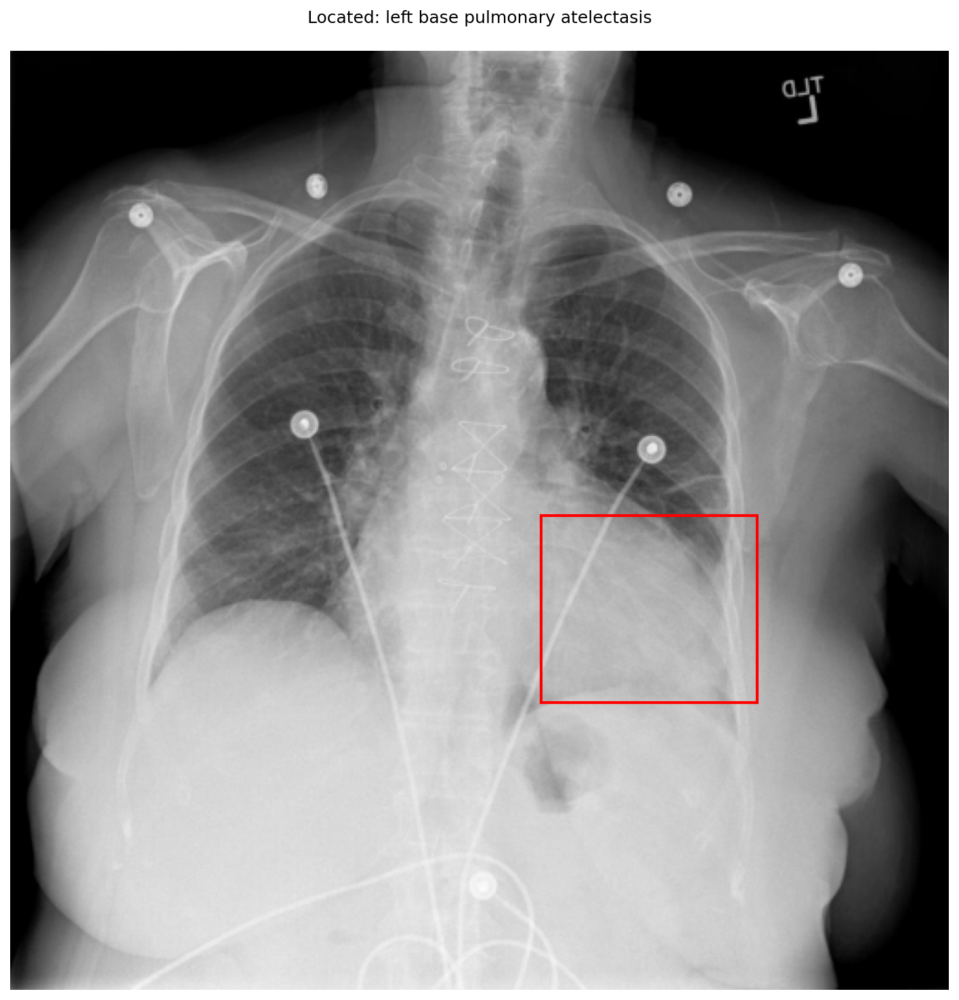

# chexbench_openi_0034
Ordinal 273; source OpenI; stopped-prefix record.

Which finding is in this chest X-ray?

## Complete options

- **A**: right base pulmonary atelectasis
- **B**: left base pulmonary atelectasis

## Original images

Explicit answer: **B. left base pulmonary atelectasis**; reference: **B**; correct: **True**.

Phrase grounding and expert models consistently localize increased opacity and volume loss to the left lung base, confirming left base atelectasis.

[Prediction](../../evidence/chexbench/predictions/M43-IM-GT-S50-CXR6/chexbench_openi_0034.json) · [own post-prediction feedback](../../evidence/chexbench/feedback/chexbench_openi_0034.json) · [exact context and Skill version](../../evidence/chexbench/contexts/chexbench_openi_0034.json) · [all main requests/responses](../../evidence/chexbench/services/calls/R50-AGENT/chexbench_openi_0034)

## Tool requests and observations

- medgemma: status=completed; [selection](../../evidence/chexbench/services/tool_selections/R50-AGENT/chexbench_openi_0034/1.json), [full request/result/stdout/stderr artifacts](../../evidence/chexbench/services/tool_cache/d094f040e0ebaa5c79a3a0c7b7f24aee27a5674b573e0a680a9d433d598b1566).
- chest_xray_expert: status=completed; [selection](../../evidence/chexbench/services/tool_selections/R50-AGENT/chexbench_openi_0034/2.json), [full request/result/stdout/stderr artifacts](../../evidence/chexbench/services/tool_cache/a65290b8b4f5114b348f37028f6a3d8fcee2149cfbb24dbe9d72a2768354e07a).
- xray_phrase_grounding: status=completed; [selection](../../evidence/chexbench/services/tool_selections/R50-AGENT/chexbench_openi_0034/3.json), [full request/result/stdout/stderr artifacts](../../evidence/chexbench/services/tool_cache/ffc46a8a9ec7929c7e9958bfe64459947eee55f299cb4e961cf5183ead48976f).

## Skill and prior-image provenance

Selected IDs: []; prior same-image IDs: [].

This is dataset-label scoring and model/tool narrative, not clinical adjudication or Skill causal verification.
