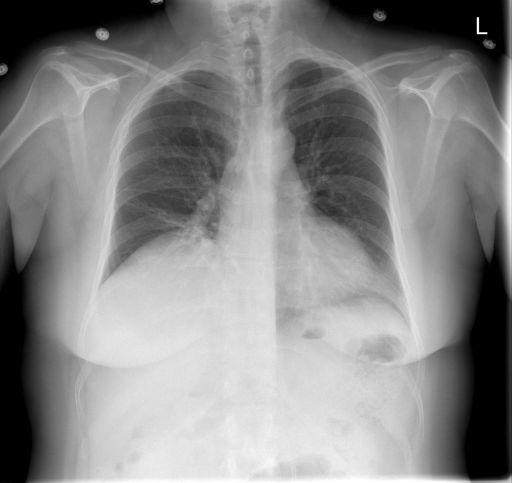
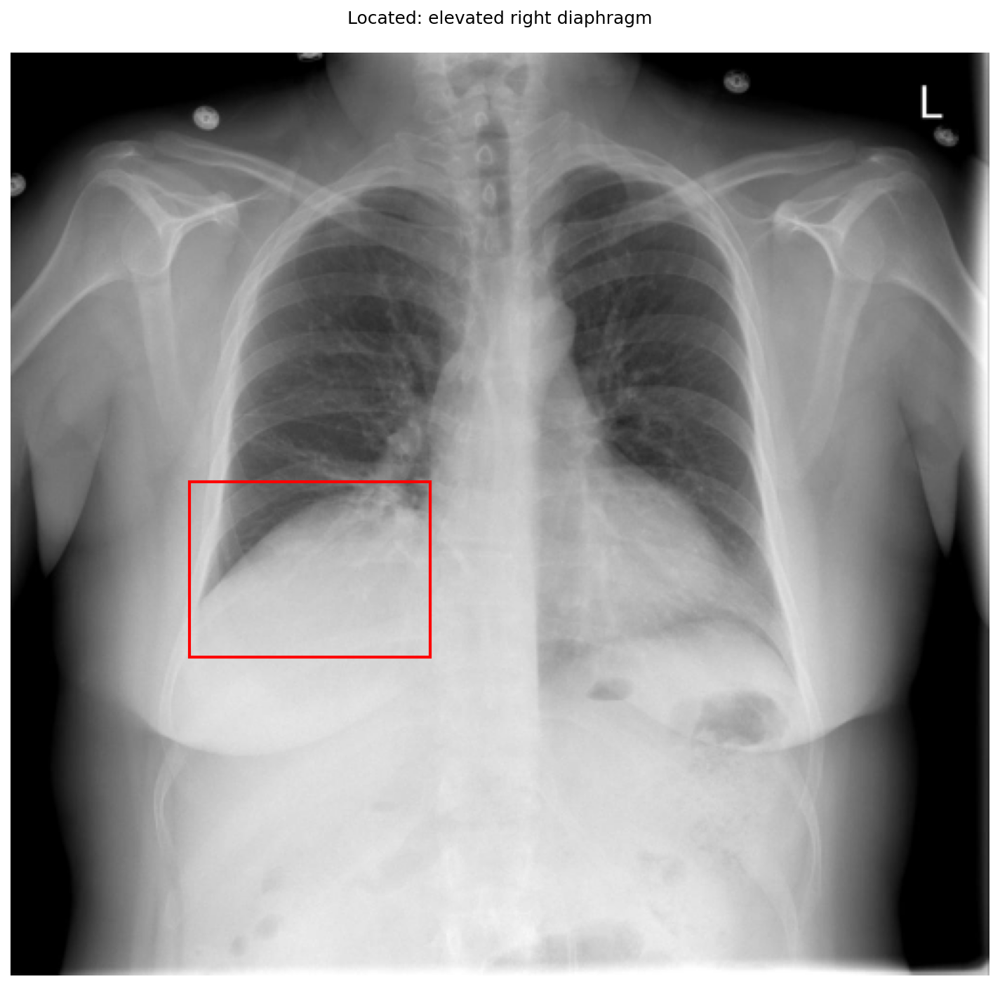
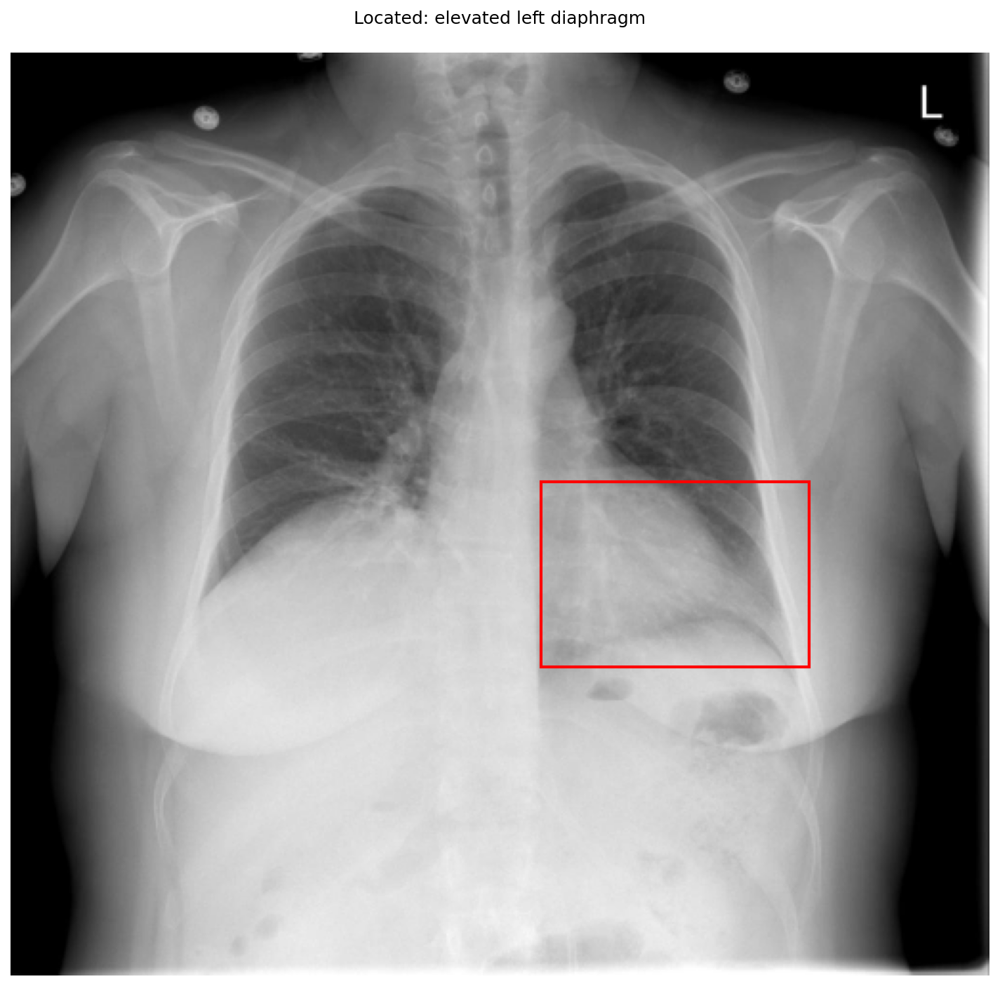

# chexbench_openi_0035
Ordinal 274; source OpenI; stopped-prefix record.

Which finding is in this chest X-ray?

## Complete options

- **A**: elevated right diaphragm
- **B**: elevated left diaphragm

## Original images

Explicit answer: **A. elevated right diaphragm**; reference: **A**; correct: **True**.

The right hemidiaphragm is visibly higher than the left, with the gastric bubble located below the lower left hemidiaphragm, confirming right-sided elevation.

[Prediction](../../evidence/chexbench/predictions/M43-IM-GT-S50-CXR6/chexbench_openi_0035.json) · [own post-prediction feedback](../../evidence/chexbench/feedback/chexbench_openi_0035.json) · [exact context and Skill version](../../evidence/chexbench/contexts/chexbench_openi_0035.json) · [all main requests/responses](../../evidence/chexbench/services/calls/R50-AGENT/chexbench_openi_0035)

## Tool requests and observations

- xray_phrase_grounding: status=completed; [selection](../../evidence/chexbench/services/tool_selections/R50-AGENT/chexbench_openi_0035/1.json), [full request/result/stdout/stderr artifacts](../../evidence/chexbench/services/tool_cache/4519857d476bb42654511cc919048dd68f5c0cb219ed784befc0a1ada8d630ac).

- xray_phrase_grounding: status=completed; [selection](../../evidence/chexbench/services/tool_selections/R50-AGENT/chexbench_openi_0035/2.json), [full request/result/stdout/stderr artifacts](../../evidence/chexbench/services/tool_cache/02ef65fa443a16a498ccd5f3a09b7428f67b7ff21424c66f7774108729f7238d).

## Skill and prior-image provenance

Selected IDs: []; prior same-image IDs: [].

This is dataset-label scoring and model/tool narrative, not clinical adjudication or Skill causal verification.
