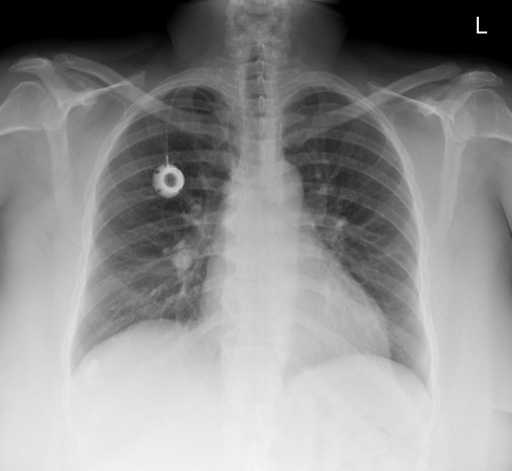
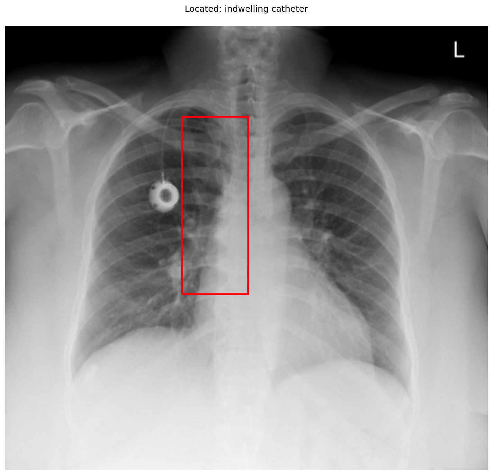

# chexbench_openi_0036
Ordinal 275; source OpenI; stopped-prefix record.

Which finding is in this chest X-ray?

## Complete options

- **A**: right indwelling catheter
- **B**: left indwelling catheter

## Original images

Explicit answer: **A. right indwelling catheter**; reference: **A**; correct: **True**.

The port-a-cath device is visualized in the right upper chest, and the 'L' marker confirms standard orientation where the viewer's left corresponds to the patient's right side.

[Prediction](../../evidence/chexbench/predictions/M43-IM-GT-S50-CXR6/chexbench_openi_0036.json) · [own post-prediction feedback](../../evidence/chexbench/feedback/chexbench_openi_0036.json) · [exact context and Skill version](../../evidence/chexbench/contexts/chexbench_openi_0036.json) · [all main requests/responses](../../evidence/chexbench/services/calls/R50-AGENT/chexbench_openi_0036)

## Tool requests and observations

- xray_phrase_grounding: status=completed; [selection](../../evidence/chexbench/services/tool_selections/R50-AGENT/chexbench_openi_0036/1.json), [full request/result/stdout/stderr artifacts](../../evidence/chexbench/services/tool_cache/e48af87817a9be80d5fbca2c0743300cf71fc31b6ab7d16407eb4a9781613c6f).

## Skill and prior-image provenance

Selected IDs: []; prior same-image IDs: [].

This is dataset-label scoring and model/tool narrative, not clinical adjudication or Skill causal verification.
