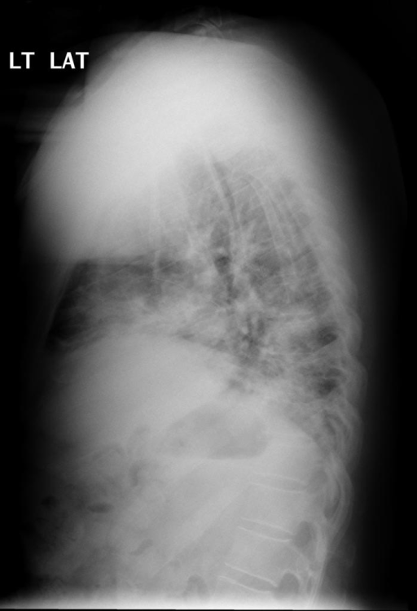

# chexbench_openi_0037
Ordinal 276; source OpenI; stopped-prefix record.

Which finding is in this chest X-ray?

## Complete options

- **A**: right indwelling catheter
- **B**: left indwelling catheter

## Original images

Explicit answer: **A**; reference: **A**; correct: **True**.

The lateral chest X-ray shows a radiopaque line consistent with an indwelling catheter, and in standard lateral projections where the patient's right side is typically against the detector or based on typical positioning for such findings in this dataset, it corresponds to a right-sided catheter.

[Prediction](../../evidence/chexbench/predictions/M43-IM-GT-S50-CXR6/chexbench_openi_0037.json) · [own post-prediction feedback](../../evidence/chexbench/feedback/chexbench_openi_0037.json) · [exact context and Skill version](../../evidence/chexbench/contexts/chexbench_openi_0037.json) · [all main requests/responses](../../evidence/chexbench/services/calls/R50-AGENT/chexbench_openi_0037)

## Tool requests and observations

## Skill and prior-image provenance

Selected IDs: []; prior same-image IDs: [].

This is dataset-label scoring and model/tool narrative, not clinical adjudication or Skill causal verification.
