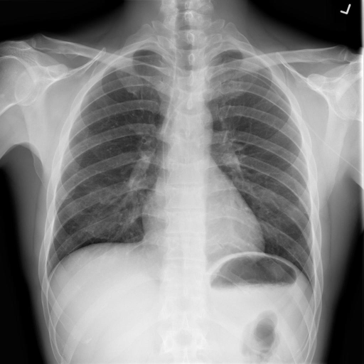
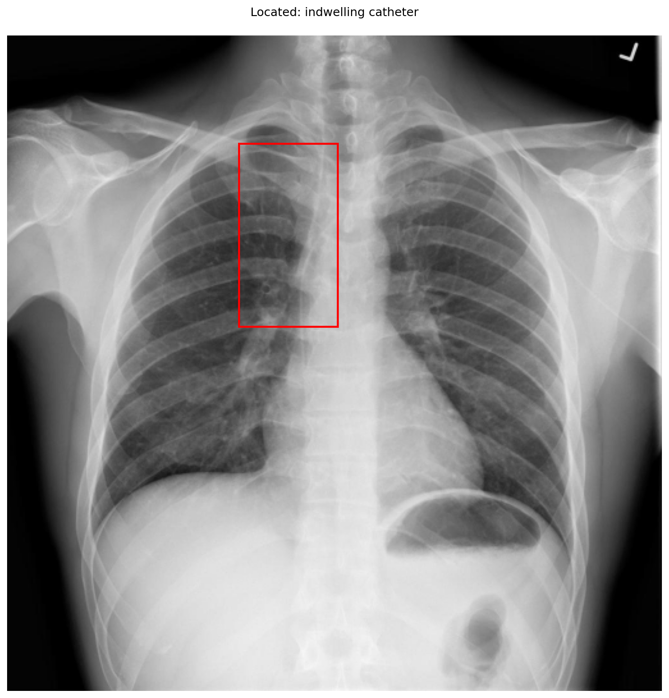

# chexbench_openi_0038
Ordinal 277; source OpenI; stopped-prefix record.

Which finding is in this chest X-ray?

## Complete options

- **A**: left indwelling catheter
- **B**: right indwelling catheter

## Original images

Explicit answer: **A. left indwelling catheter**; reference: **B**; correct: **False**.

Two expert VLMs independently identified a left-sided indwelling catheter (PICC line) and explicitly excluded a right-sided catheter.

[Prediction](../../evidence/chexbench/predictions/M43-IM-GT-S50-CXR6/chexbench_openi_0038.json) · [own post-prediction feedback](../../evidence/chexbench/feedback/chexbench_openi_0038.json) · [exact context and Skill version](../../evidence/chexbench/contexts/chexbench_openi_0038.json) · [all main requests/responses](../../evidence/chexbench/services/calls/R50-AGENT/chexbench_openi_0038)

## Tool requests and observations

- xray_phrase_grounding: status=completed; [selection](../../evidence/chexbench/services/tool_selections/R50-AGENT/chexbench_openi_0038/1.json), [full request/result/stdout/stderr artifacts](../../evidence/chexbench/services/tool_cache/6050f06928f0812cf3e0b0bd75a3e10a9aa1c6956d6fec8745e7e5edd0eb39f6).

- chest_xray_expert: status=completed; [selection](../../evidence/chexbench/services/tool_selections/R50-AGENT/chexbench_openi_0038/2.json), [full request/result/stdout/stderr artifacts](../../evidence/chexbench/services/tool_cache/bcfe9f8a1375fc30adaf01375768fb0b9a7d7c79d2fb342d2dfe7eb7e712fa58).
- llava_rad: status=completed; [selection](../../evidence/chexbench/services/tool_selections/R50-AGENT/chexbench_openi_0038/3.json), [full request/result/stdout/stderr artifacts](../../evidence/chexbench/services/tool_cache/2904615ea8a911200eb632335a7f269087ce963fc00a400959cd0b934b480c36).

## Skill and prior-image provenance

Selected IDs: []; prior same-image IDs: [].

This is dataset-label scoring and model/tool narrative, not clinical adjudication or Skill causal verification.
