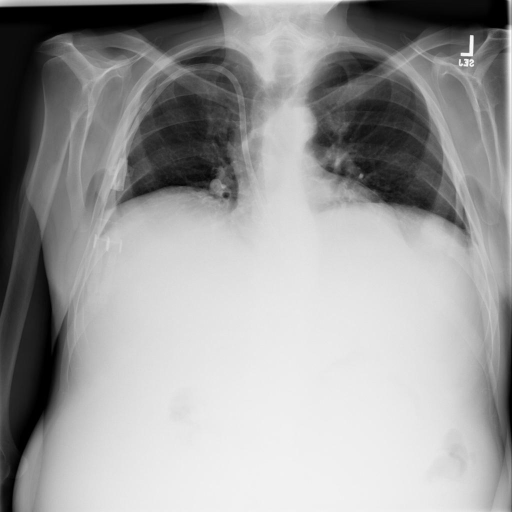
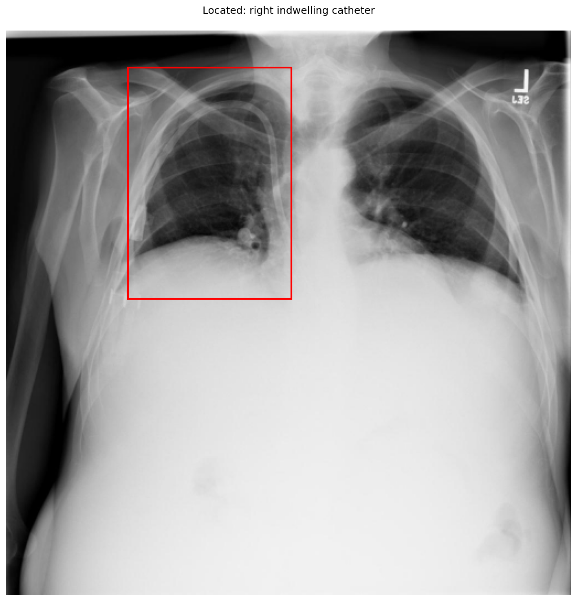
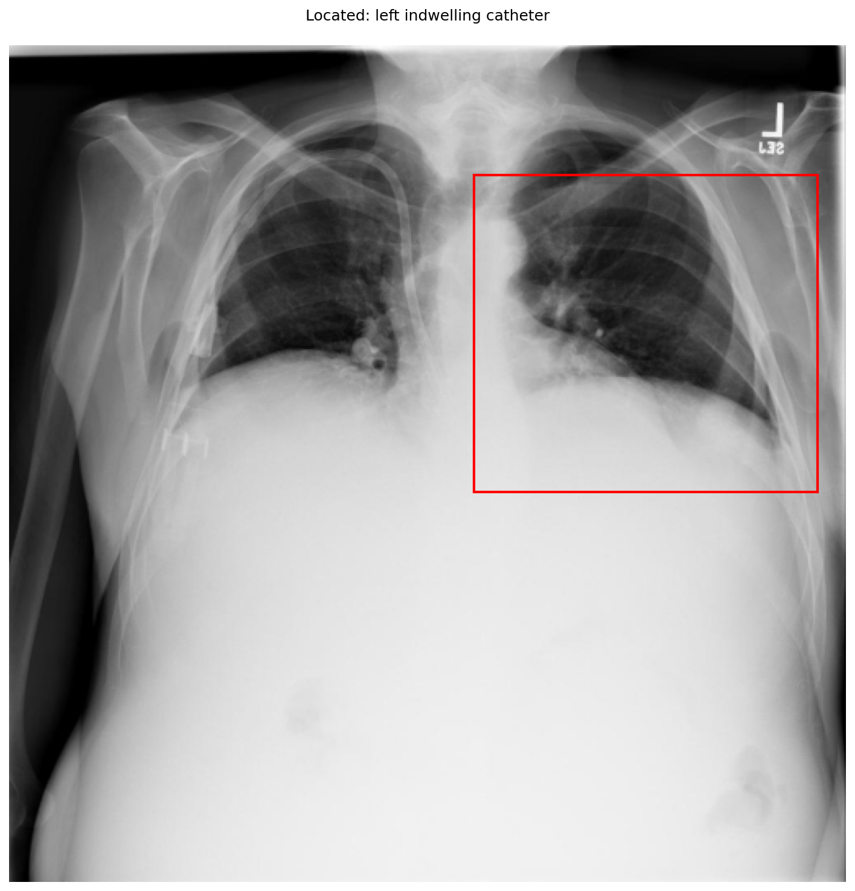

# chexbench_openi_0039
Ordinal 278; source OpenI; stopped-prefix record.

Which finding is in this chest X-ray?

## Complete options

- **A**: right indwelling catheter
- **B**: left indwelling catheter

## Original images

Explicit answer: **A. right indwelling catheter**; reference: **A**; correct: **True**.

The grounding visualization confirms a visible catheter line on the patient's right side (image left), while the left side shows no such device.

[Prediction](../../evidence/chexbench/predictions/M43-IM-GT-S50-CXR6/chexbench_openi_0039.json) · [own post-prediction feedback](../../evidence/chexbench/feedback/chexbench_openi_0039.json) · [exact context and Skill version](../../evidence/chexbench/contexts/chexbench_openi_0039.json) · [all main requests/responses](../../evidence/chexbench/services/calls/R50-AGENT/chexbench_openi_0039)

## Tool requests and observations

- xray_phrase_grounding: status=completed; [selection](../../evidence/chexbench/services/tool_selections/R50-AGENT/chexbench_openi_0039/1.json), [full request/result/stdout/stderr artifacts](../../evidence/chexbench/services/tool_cache/3e24c0e899e35f56fc63f3c1bfda5d74c8464b449c78e5290e1451a4ae74f5d7).

- xray_phrase_grounding: status=completed; [selection](../../evidence/chexbench/services/tool_selections/R50-AGENT/chexbench_openi_0039/2.json), [full request/result/stdout/stderr artifacts](../../evidence/chexbench/services/tool_cache/029cbf0cfef31b7bd508cf51a8de8815d14194f9b8a96d809a04c77280a7d38e).

## Skill and prior-image provenance

Selected IDs: []; prior same-image IDs: [].

This is dataset-label scoring and model/tool narrative, not clinical adjudication or Skill causal verification.
