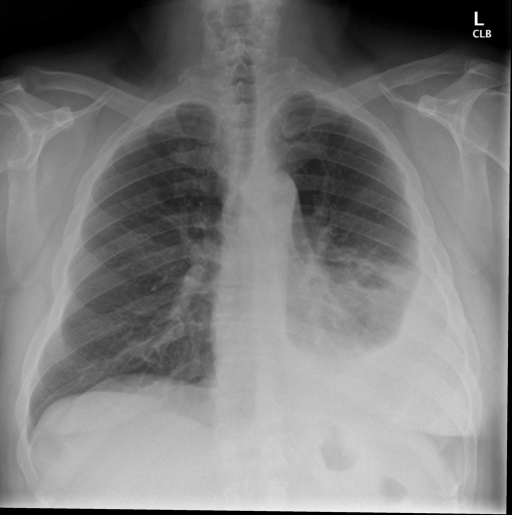
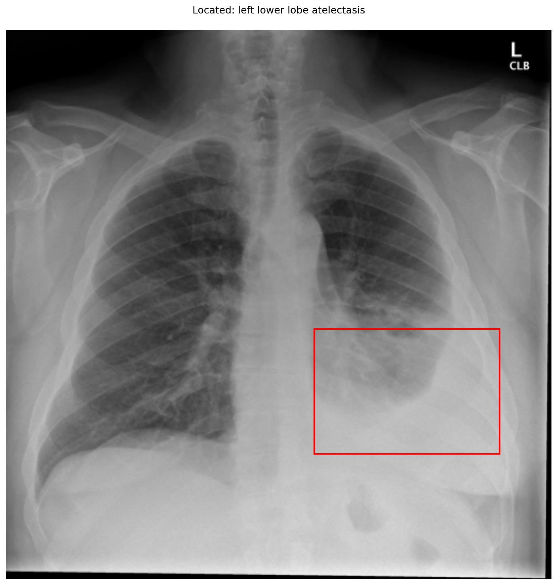

# chexbench_openi_0040
Ordinal 279; source OpenI; stopped-prefix record.

Which finding is in this chest X-ray?

## Complete options

- **A**: left lower lobe pulmonary atelectasis
- **B**: right lower lobe pulmonary atelectasis

## Original images

Explicit answer: **A. left lower lobe pulmonary atelectasis**; reference: **A**; correct: **True**.

The chest X-ray shows increased opacity and volume loss in the left lower lung field, consistent with left lower lobe atelectasis, as confirmed by visual grounding and expert model analysis.

[Prediction](../../evidence/chexbench/predictions/M43-IM-GT-S50-CXR6/chexbench_openi_0040.json) · [own post-prediction feedback](../../evidence/chexbench/feedback/chexbench_openi_0040.json) · [exact context and Skill version](../../evidence/chexbench/contexts/chexbench_openi_0040.json) · [all main requests/responses](../../evidence/chexbench/services/calls/R50-AGENT/chexbench_openi_0040)

## Tool requests and observations

- medgemma: status=completed; [selection](../../evidence/chexbench/services/tool_selections/R50-AGENT/chexbench_openi_0040/1.json), [full request/result/stdout/stderr artifacts](../../evidence/chexbench/services/tool_cache/8e2f016bd4940d24bafd2f2c95dd1a81bdc5e7db1a1d04af67f810bd81a846c4).
- chest_xray_expert: status=completed; [selection](../../evidence/chexbench/services/tool_selections/R50-AGENT/chexbench_openi_0040/2.json), [full request/result/stdout/stderr artifacts](../../evidence/chexbench/services/tool_cache/0250f463da91e1aaf129c9238797e0fbc3e8bd2f5c9288950392a77c8cc224dc).
- xray_phrase_grounding: status=completed; [selection](../../evidence/chexbench/services/tool_selections/R50-AGENT/chexbench_openi_0040/3.json), [full request/result/stdout/stderr artifacts](../../evidence/chexbench/services/tool_cache/ceeafe7891b7e41c5bddee7571e849b89fc424cec85b1592d5d4e74840f2c402).

## Skill and prior-image provenance

Selected IDs: []; prior same-image IDs: [].

This is dataset-label scoring and model/tool narrative, not clinical adjudication or Skill causal verification.
