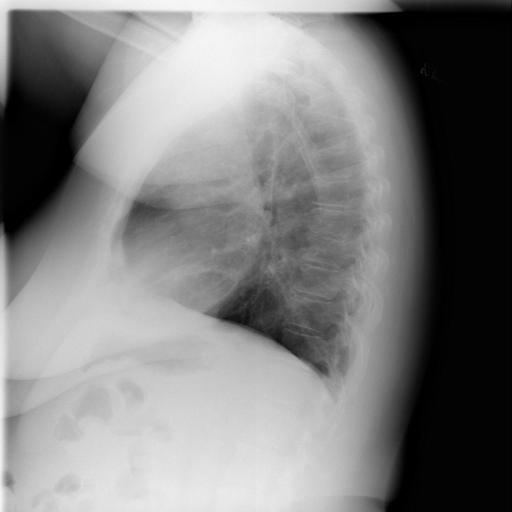

# chexbench_openi_0041
Ordinal 280; source OpenI; stopped-prefix record.

Which finding is in this chest X-ray?

## Complete options

- **A**: left lower lobe pulmonary atelectasis
- **B**: right lower lobe pulmonary atelectasis

## Original images

Explicit answer: **A. left lower lobe pulmonary atelectasis**; reference: **A**; correct: **True**.

Llava_rad identified increased retrocardiac opacity suggesting left lower lobe atelectasis, which is the classic lateral view sign for this condition.

[Prediction](../../evidence/chexbench/predictions/M43-IM-GT-S50-CXR6/chexbench_openi_0041.json) · [own post-prediction feedback](../../evidence/chexbench/feedback/chexbench_openi_0041.json) · [exact context and Skill version](../../evidence/chexbench/contexts/chexbench_openi_0041.json) · [all main requests/responses](../../evidence/chexbench/services/calls/R50-AGENT/chexbench_openi_0041)

## Tool requests and observations

- medgemma: status=completed; [selection](../../evidence/chexbench/services/tool_selections/R50-AGENT/chexbench_openi_0041/1.json), [full request/result/stdout/stderr artifacts](../../evidence/chexbench/services/tool_cache/26b55b68ef7d413fbde583cb3792b17cc5aff80f294d256a6b81ee4358102a92).
- chest_xray_expert: status=completed; [selection](../../evidence/chexbench/services/tool_selections/R50-AGENT/chexbench_openi_0041/2.json), [full request/result/stdout/stderr artifacts](../../evidence/chexbench/services/tool_cache/1b173e955ae416483422d750ca85dc58af6b2dd6a2fe1f67ee09803fbf5f34df).
- llava_rad: status=completed; [selection](../../evidence/chexbench/services/tool_selections/R50-AGENT/chexbench_openi_0041/3.json), [full request/result/stdout/stderr artifacts](../../evidence/chexbench/services/tool_cache/ed219dcaf7b616020121bff90e5d4a3272625f6bba541bda244a45171b501428).
- xray_phrase_grounding: status=completed; [selection](../../evidence/chexbench/services/tool_selections/R50-AGENT/chexbench_openi_0041/4.json), [full request/result/stdout/stderr artifacts](../../evidence/chexbench/services/tool_cache/fee3f8d2753e5511b6d3a0c21101b0af2faa7c48e8b979cc3e8f41df50c0a35d).
- medvlm_r1: status=completed; [selection](../../evidence/chexbench/services/tool_selections/R50-AGENT/chexbench_openi_0041/5.json), [full request/result/stdout/stderr artifacts](../../evidence/chexbench/services/tool_cache/a4e5294b45b1864592653af674e6ec1a1225bb81271a014d9bbe27d481b5ce1b).

## Skill and prior-image provenance

Selected IDs: []; prior same-image IDs: [].

This is dataset-label scoring and model/tool narrative, not clinical adjudication or Skill causal verification.
