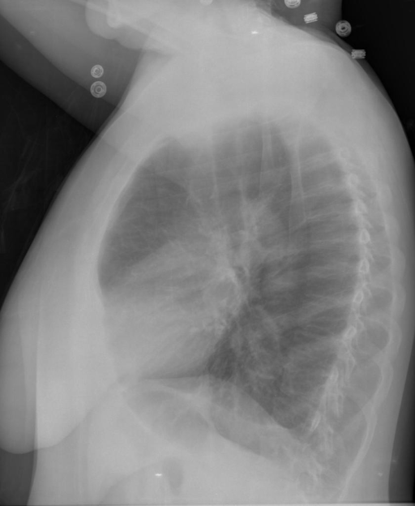
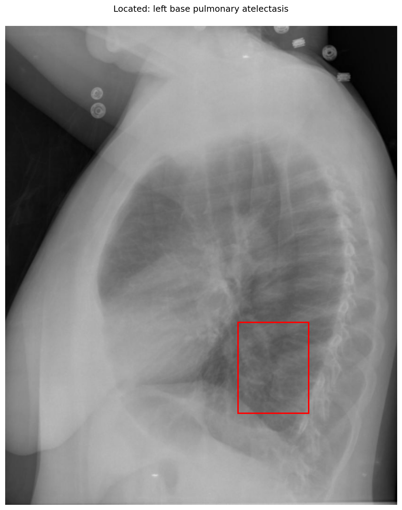

# chexbench_openi_0042
Ordinal 281; source OpenI; stopped-prefix record.

Which finding is in this chest X-ray?

## Complete options

- **A**: left base pulmonary atelectasis
- **B**: right base pulmonary atelectasis

## Original images

Explicit answer: **A. left base pulmonary atelectasis**; reference: **B**; correct: **False**.

Phrase grounding successfully localized left base pulmonary atelectasis in the posterior basal region, while right base grounding returned no findings.

[Prediction](../../evidence/chexbench/predictions/M43-IM-GT-S50-CXR6/chexbench_openi_0042.json) · [own post-prediction feedback](../../evidence/chexbench/feedback/chexbench_openi_0042.json) · [exact context and Skill version](../../evidence/chexbench/contexts/chexbench_openi_0042.json) · [all main requests/responses](../../evidence/chexbench/services/calls/R50-AGENT/chexbench_openi_0042)

## Tool requests and observations

- medgemma: status=completed; [selection](../../evidence/chexbench/services/tool_selections/R50-AGENT/chexbench_openi_0042/1.json), [full request/result/stdout/stderr artifacts](../../evidence/chexbench/services/tool_cache/434fb25f353ddaf1b7e2ab3381092bc101e197f43a8d98de4e46984db47a7e63).
- chest_xray_expert: status=completed; [selection](../../evidence/chexbench/services/tool_selections/R50-AGENT/chexbench_openi_0042/2.json), [full request/result/stdout/stderr artifacts](../../evidence/chexbench/services/tool_cache/4929718d240f582a78115c7f96de3f8b803c72f5fcd0147992d5dfd2f39fd436).
- xray_phrase_grounding: status=completed; [selection](../../evidence/chexbench/services/tool_selections/R50-AGENT/chexbench_openi_0042/3.json), [full request/result/stdout/stderr artifacts](../../evidence/chexbench/services/tool_cache/9286ca3d61567dd53b158037b445724601227b1b28ed93664fa5360877dcdec4).
- xray_phrase_grounding: status=completed; [selection](../../evidence/chexbench/services/tool_selections/R50-AGENT/chexbench_openi_0042/4.json), [full request/result/stdout/stderr artifacts](../../evidence/chexbench/services/tool_cache/70fd881375e9029985226de9a871df3b7d299a654e265a55a41db5fb646d3e24).

## Skill and prior-image provenance

Selected IDs: []; prior same-image IDs: [].

This is dataset-label scoring and model/tool narrative, not clinical adjudication or Skill causal verification.
