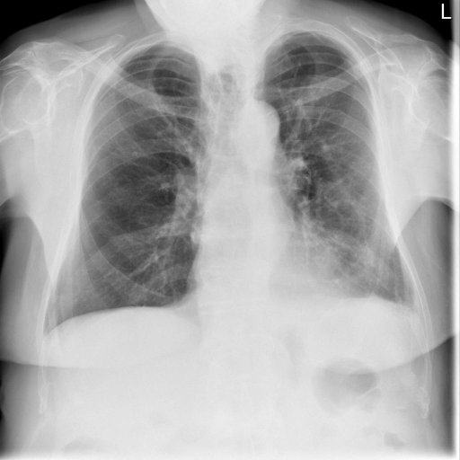
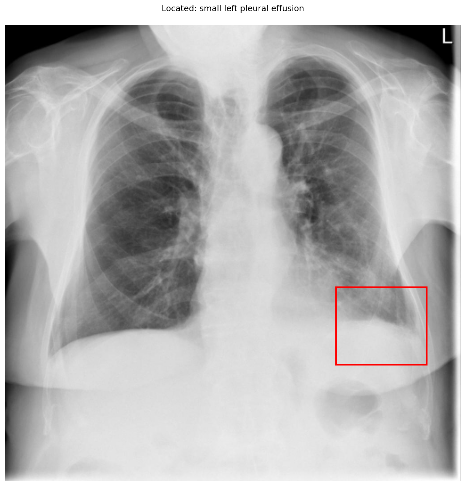

# chexbench_openi_0043
Ordinal 282; source OpenI; stopped-prefix record.

Which finding is in this chest X-ray?

## Complete options

- **A**: small left pleural effusion
- **B**: small right pleural effusion

## Original images

Explicit answer: **A. small left pleural effusion**; reference: **A**; correct: **True**.

The grounding tool localized blunting at the left costophrenic angle (image coordinates [0.72, 0.57, 0.92, 0.74]), consistent with a small left pleural effusion, while the right costophrenic angle appears sharp.

[Prediction](../../evidence/chexbench/predictions/M43-IM-GT-S50-CXR6/chexbench_openi_0043.json) · [own post-prediction feedback](../../evidence/chexbench/feedback/chexbench_openi_0043.json) · [exact context and Skill version](../../evidence/chexbench/contexts/chexbench_openi_0043.json) · [all main requests/responses](../../evidence/chexbench/services/calls/R50-AGENT/chexbench_openi_0043)

## Tool requests and observations

- medgemma: status=completed; [selection](../../evidence/chexbench/services/tool_selections/R50-AGENT/chexbench_openi_0043/1.json), [full request/result/stdout/stderr artifacts](../../evidence/chexbench/services/tool_cache/284fe5ad04dd8d1ece521c984f89e094116628211e448a3a7b557af1fde90536).
- xray_phrase_grounding: status=completed; [selection](../../evidence/chexbench/services/tool_selections/R50-AGENT/chexbench_openi_0043/2.json), [full request/result/stdout/stderr artifacts](../../evidence/chexbench/services/tool_cache/9787e82a0ebf27e26015bc169a5583547a0dd2e219451358cf1388d760990568).

## Skill and prior-image provenance

Selected IDs: []; prior same-image IDs: [].

This is dataset-label scoring and model/tool narrative, not clinical adjudication or Skill causal verification.
