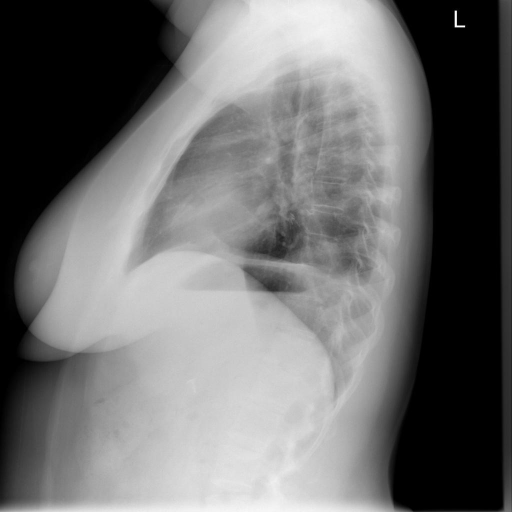
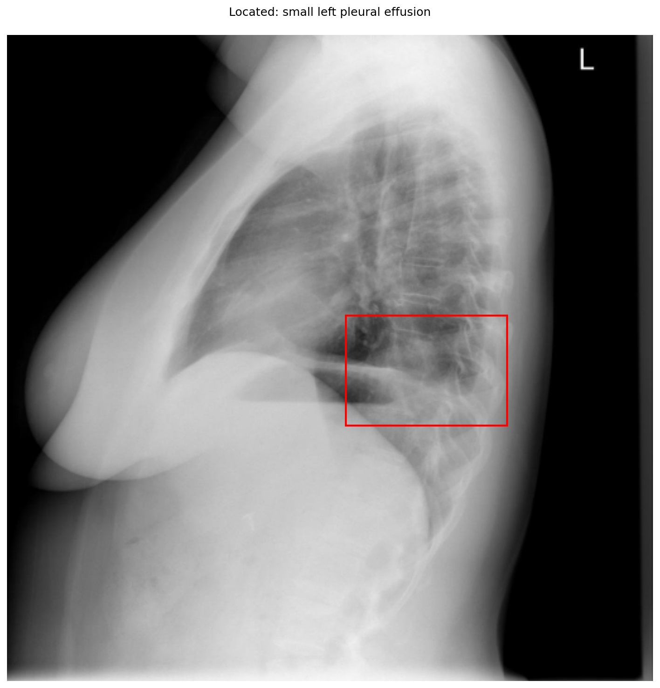

# chexbench_openi_0044
Ordinal 283; source OpenI; stopped-prefix record.

Which finding is in this chest X-ray?

## Complete options

- **A**: small left pleural effusion
- **B**: small right pleural effusion

## Original images

Explicit answer: **A. small left pleural effusion**; reference: **A**; correct: **True**.

The phrase grounding tool localized a finding consistent with a small left pleural effusion in the posterior costophrenic region on this lateral chest X-ray, and the CheXagent model also identified 'Left' as the affected side.

[Prediction](../../evidence/chexbench/predictions/M43-IM-GT-S50-CXR6/chexbench_openi_0044.json) · [own post-prediction feedback](../../evidence/chexbench/feedback/chexbench_openi_0044.json) · [exact context and Skill version](../../evidence/chexbench/contexts/chexbench_openi_0044.json) · [all main requests/responses](../../evidence/chexbench/services/calls/R50-AGENT/chexbench_openi_0044)

## Tool requests and observations

- medgemma: status=completed; [selection](../../evidence/chexbench/services/tool_selections/R50-AGENT/chexbench_openi_0044/1.json), [full request/result/stdout/stderr artifacts](../../evidence/chexbench/services/tool_cache/ea523bd1fc5df84aee63d4c2063cc72267e93b52f186c57991ec97af80cf5299).
- chest_xray_expert: status=completed; [selection](../../evidence/chexbench/services/tool_selections/R50-AGENT/chexbench_openi_0044/2.json), [full request/result/stdout/stderr artifacts](../../evidence/chexbench/services/tool_cache/21d516ab8038ec083a2f77e7dccc5b59671b33aec495aa855aa6a095985ef18a).
- xray_phrase_grounding: status=completed; [selection](../../evidence/chexbench/services/tool_selections/R50-AGENT/chexbench_openi_0044/3.json), [full request/result/stdout/stderr artifacts](../../evidence/chexbench/services/tool_cache/b7108057b02725ea736eefb730e209d07178ef56d8df44e26ba5db6c642e3fbb).

## Skill and prior-image provenance

Selected IDs: []; prior same-image IDs: [].

This is dataset-label scoring and model/tool narrative, not clinical adjudication or Skill causal verification.
