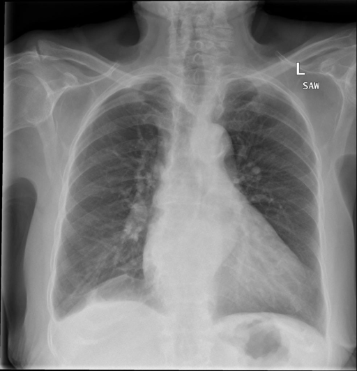

# chexbench_openi_0045
Ordinal 284; source OpenI; stopped-prefix record.

Which finding is in this chest X-ray?

## Complete options

- **A**: right base pulmonary atelectasis
- **B**: left base pulmonary atelectasis

## Original images

Explicit answer: **A. right base pulmonary atelectasis**; reference: **A**; correct: **True**.

Both medgemma and chest_xray_expert independently identify increased opacity consistent with atelectasis at the right lung base.

[Prediction](../../evidence/chexbench/predictions/M43-IM-GT-S50-CXR6/chexbench_openi_0045.json) · [own post-prediction feedback](../../evidence/chexbench/feedback/chexbench_openi_0045.json) · [exact context and Skill version](../../evidence/chexbench/contexts/chexbench_openi_0045.json) · [all main requests/responses](../../evidence/chexbench/services/calls/R50-AGENT/chexbench_openi_0045)

## Tool requests and observations

- medgemma: status=completed; [selection](../../evidence/chexbench/services/tool_selections/R50-AGENT/chexbench_openi_0045/1.json), [full request/result/stdout/stderr artifacts](../../evidence/chexbench/services/tool_cache/f0bb2956c7e5f0020eb1053726bcce90fe9232b7f6ea666f323e72ffb5896a65).
- chest_xray_expert: status=completed; [selection](../../evidence/chexbench/services/tool_selections/R50-AGENT/chexbench_openi_0045/2.json), [full request/result/stdout/stderr artifacts](../../evidence/chexbench/services/tool_cache/c6caf8584a84ebf0b074c7205dee749d644c957382c2a2fd943b250cdfd00064).

## Skill and prior-image provenance

Selected IDs: []; prior same-image IDs: ['chexbench_rad_restruct_0172'].

This is dataset-label scoring and model/tool narrative, not clinical adjudication or Skill causal verification.
