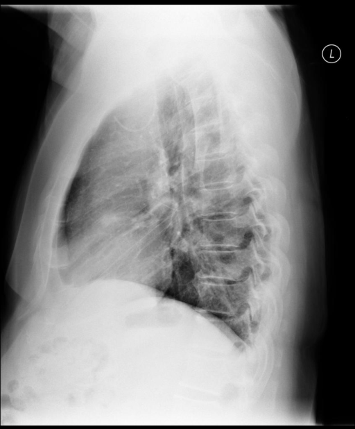

# chexbench_openi_0046
Ordinal 285; source OpenI; stopped-prefix record.

Which finding is in this chest X-ray?

## Complete options

- **A**: left indwelling catheter
- **B**: right indwelling catheter

## Original images

Explicit answer: **A. left indwelling catheter**; reference: **B**; correct: **False**.

Multiple VLM tools (medgemma, llava_rad) consistently identify a left-sided indwelling catheter in the lateral chest X-ray.

[Prediction](../../evidence/chexbench/predictions/M43-IM-GT-S50-CXR6/chexbench_openi_0046.json) · [own post-prediction feedback](../../evidence/chexbench/feedback/chexbench_openi_0046.json) · [exact context and Skill version](../../evidence/chexbench/contexts/chexbench_openi_0046.json) · [all main requests/responses](../../evidence/chexbench/services/calls/R50-AGENT/chexbench_openi_0046)

## Tool requests and observations

- medgemma: status=completed; [selection](../../evidence/chexbench/services/tool_selections/R50-AGENT/chexbench_openi_0046/1.json), [full request/result/stdout/stderr artifacts](../../evidence/chexbench/services/tool_cache/72630bc146ededa225f9d6d06b64ca5a69b7cfbc64efc75e0ae9e0089d363ce4).
- xray_phrase_grounding: status=completed; [selection](../../evidence/chexbench/services/tool_selections/R50-AGENT/chexbench_openi_0046/2.json), [full request/result/stdout/stderr artifacts](../../evidence/chexbench/services/tool_cache/e780492d7a08e26960c60d653de11b0596f7c963b4efe01c3d107c5566a47c3f).
- chest_xray_expert: status=completed; [selection](../../evidence/chexbench/services/tool_selections/R50-AGENT/chexbench_openi_0046/3.json), [full request/result/stdout/stderr artifacts](../../evidence/chexbench/services/tool_cache/f28e1bf7804bbf7913a91fd2902d3cf1f4d060455e7b87d02e9d11f237280b9c).
- llava_rad: status=completed; [selection](../../evidence/chexbench/services/tool_selections/R50-AGENT/chexbench_openi_0046/4.json), [full request/result/stdout/stderr artifacts](../../evidence/chexbench/services/tool_cache/a4bbbb0a4544580bcc2d1412a0ba95a71447b56e6e53ab9329efbd8aff0d96b5).

## Skill and prior-image provenance

Selected IDs: []; prior same-image IDs: [].

This is dataset-label scoring and model/tool narrative, not clinical adjudication or Skill causal verification.
