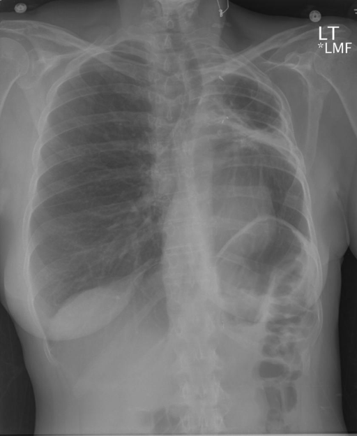
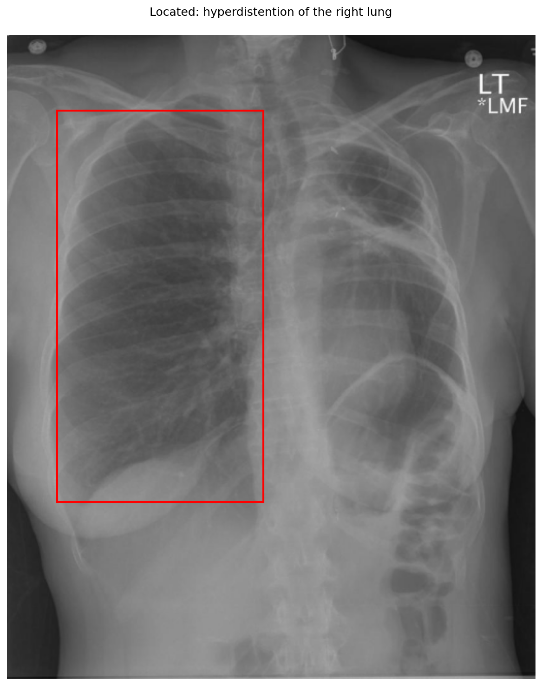

# chexbench_openi_0048
Ordinal 287; source OpenI; stopped-prefix record.

Which finding is in this chest X-ray?

## Complete options

- **A**: hyperdistention of the left lung
- **B**: hyperdistention of the right lung

## Original images

Explicit answer: **B. hyperdistention of the right lung**; reference: **B**; correct: **True**.

The grounding tool successfully localized hyperdistention to the right lung (viewer's left), which appears hyperlucent and expanded compared to the fibrotic, volume-loss left lung.

[Prediction](../../evidence/chexbench/predictions/M43-IM-GT-S50-CXR6/chexbench_openi_0048.json) · [own post-prediction feedback](../../evidence/chexbench/feedback/chexbench_openi_0048.json) · [exact context and Skill version](../../evidence/chexbench/contexts/chexbench_openi_0048.json) · [all main requests/responses](../../evidence/chexbench/services/calls/R50-AGENT/chexbench_openi_0048)

## Tool requests and observations

- medgemma: status=completed; [selection](../../evidence/chexbench/services/tool_selections/R50-AGENT/chexbench_openi_0048/1.json), [full request/result/stdout/stderr artifacts](../../evidence/chexbench/services/tool_cache/d02f91f72bd9dfddc321debc5696c4e0600c411f1e72d378c394b49b983017f9).
- chest_xray_expert: status=completed; [selection](../../evidence/chexbench/services/tool_selections/R50-AGENT/chexbench_openi_0048/2.json), [full request/result/stdout/stderr artifacts](../../evidence/chexbench/services/tool_cache/d9e951cd87c3f9b7451c5e6db9026ce88e3a14b515ac66b90a9e483b77f33053).
- xray_phrase_grounding: status=completed; [selection](../../evidence/chexbench/services/tool_selections/R50-AGENT/chexbench_openi_0048/3.json), [full request/result/stdout/stderr artifacts](../../evidence/chexbench/services/tool_cache/66bad8ab749ccbf3b993f1bf097f49c3726b4a01d5bf0964010cbd7f61d74e3a).

## Skill and prior-image provenance

Selected IDs: []; prior same-image IDs: [].

This is dataset-label scoring and model/tool narrative, not clinical adjudication or Skill causal verification.
