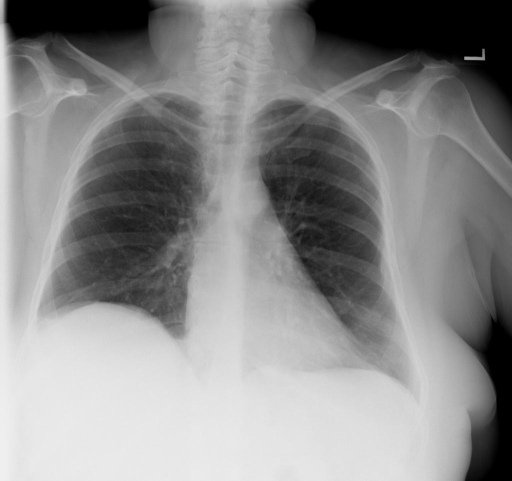
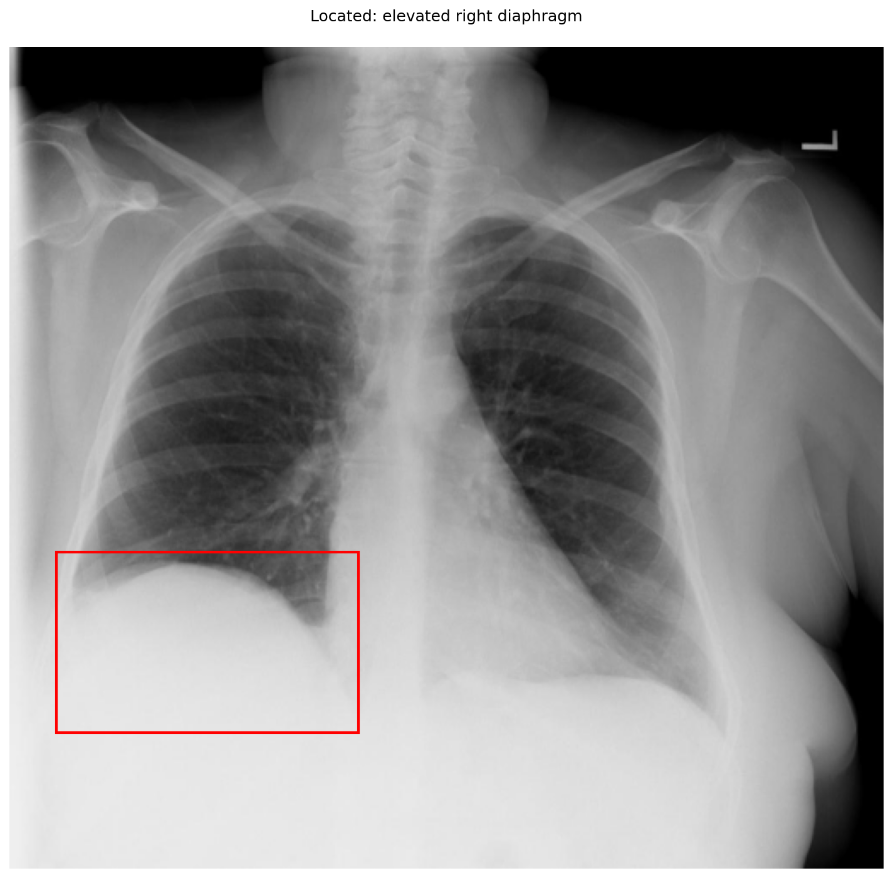

# chexbench_openi_0049
Ordinal 288; source OpenI; stopped-prefix record.

Which finding is in this chest X-ray?

## Complete options

- **A**: elevated right diaphragm
- **B**: elevated left diaphragm

## Original images

Explicit answer: **A. elevated right diaphragm**; reference: **A**; correct: **True**.

The grounding visualization confirms the elevated hemidiaphragm is on the patient's right side (viewer's left), consistent with normal anatomy where the right dome sits higher than the left.

[Prediction](../../evidence/chexbench/predictions/M43-IM-GT-S50-CXR6/chexbench_openi_0049.json) · [own post-prediction feedback](../../evidence/chexbench/feedback/chexbench_openi_0049.json) · [exact context and Skill version](../../evidence/chexbench/contexts/chexbench_openi_0049.json) · [all main requests/responses](../../evidence/chexbench/services/calls/R50-AGENT/chexbench_openi_0049)

## Tool requests and observations

- chest_xray_expert: status=completed; [selection](../../evidence/chexbench/services/tool_selections/R50-AGENT/chexbench_openi_0049/1.json), [full request/result/stdout/stderr artifacts](../../evidence/chexbench/services/tool_cache/41e3e487235ff10a09375c6250d8ac5ec54d91e32a01dbf953a84e2775fa6f8f).
- xray_phrase_grounding: status=completed; [selection](../../evidence/chexbench/services/tool_selections/R50-AGENT/chexbench_openi_0049/2.json), [full request/result/stdout/stderr artifacts](../../evidence/chexbench/services/tool_cache/42d496b9027d2e42152dff30b5f1314c5fd6f14f33f376ce402a9f0d6c879b86).

## Skill and prior-image provenance

Selected IDs: []; prior same-image IDs: [].

This is dataset-label scoring and model/tool narrative, not clinical adjudication or Skill causal verification.
