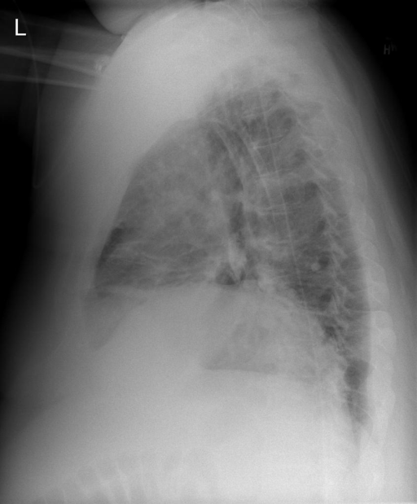

# chexbench_openi_0051
Ordinal 290; source OpenI; stopped-prefix record.

Which finding is in this chest X-ray?

## Complete options

- **A**: right base pulmonary atelectasis
- **B**: left base pulmonary atelectasis

## Original images

Explicit answer: **A. right base pulmonary atelectasis**; reference: **A**; correct: **True**.

Three independent models consistently identified right base pulmonary atelectasis on the lateral chest X-ray.

[Prediction](../../evidence/chexbench/predictions/M43-IM-GT-S50-CXR6/chexbench_openi_0051.json) · [own post-prediction feedback](../../evidence/chexbench/feedback/chexbench_openi_0051.json) · [exact context and Skill version](../../evidence/chexbench/contexts/chexbench_openi_0051.json) · [all main requests/responses](../../evidence/chexbench/services/calls/R50-AGENT/chexbench_openi_0051)

## Tool requests and observations

- medgemma: status=completed; [selection](../../evidence/chexbench/services/tool_selections/R50-AGENT/chexbench_openi_0051/1.json), [full request/result/stdout/stderr artifacts](../../evidence/chexbench/services/tool_cache/0801408bbd179b25d6012c5a52c328f7c747fcc6ce8b06041e331961ddae9e72).
- chest_xray_expert: status=completed; [selection](../../evidence/chexbench/services/tool_selections/R50-AGENT/chexbench_openi_0051/2.json), [full request/result/stdout/stderr artifacts](../../evidence/chexbench/services/tool_cache/01a7a77564b3ccbef637c54c5abeda7341e42d5eb42f4d998dfae116644b734b).
- llava_rad: status=completed; [selection](../../evidence/chexbench/services/tool_selections/R50-AGENT/chexbench_openi_0051/3.json), [full request/result/stdout/stderr artifacts](../../evidence/chexbench/services/tool_cache/d84c9b5ca0e127259d12cd4fbdb7f33b90132f1e0594f93f72ed197307a7287e).

## Skill and prior-image provenance

Selected IDs: []; prior same-image IDs: [].

This is dataset-label scoring and model/tool narrative, not clinical adjudication or Skill causal verification.
